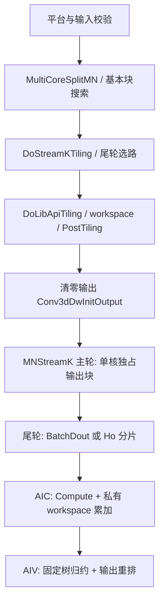
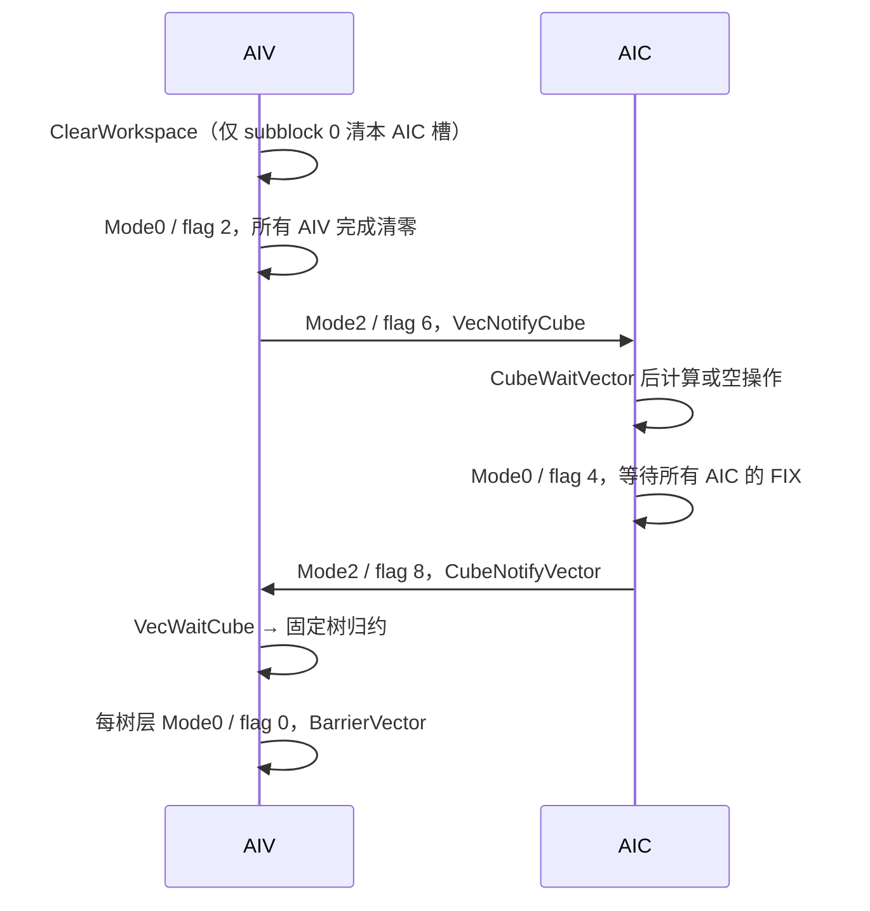

# Conv3DDW StreamK 与确定性计算：源码到模板

本篇解释 arch35 `conv3d_backprop_filter_v2` 的计算与调度；[模板入口](templates/conv3ddw_streamk_deterministic.md)给出来源、实现范围和接入方式。以下先解释指定原仓源码，再对应五文件 direct-launch 模板；原仓 Host 名称用于溯源，接入时只调用 `Conv3ddwSkDoTiling → ToCaseView → launch_conv3ddw_sk`。

## 1. 数学语义与整体代码结构

对于 groups=1，权重梯度为：

```text
dW[co,ci,kd,kh,kw] = Σ(b,do,ho,wo)
  dY[b,co,do,ho,wo] × X[b,ci,
    do*strideD-padFront+kd*dilationD,
    ho*strideH-padUp   +kh*dilationH,
    wo*strideW-padLeft +kw*dilationW]
```

越界 X 视为零。固定 `kd/group` 后，源码的矩阵视图为 `M=CoutPerGroup`、`N=CinPerGroup×Kh×Kw`、`K=Ho×Wo`，`Batch×Dout` 另作累加轴。groupEnlarge 时用 Host 生成的 `cin1G/cout1G/realGroup`，不能直接用原始 group 数套公式。

| 原始目录 | 职责 | 与本模板的关系 |
|---|---|---|
| `framework/`、`op_graph/` | 框架接入、图原型、Conv2D/3D 升级与融合 | 不参与单核归约，不提取到模板 |
| `op_host/*def.cpp`、`*infershape.cpp` | dtype/format/属性注册与输出 shape | 不提取；输入描述由 TilingIn 表达 |
| `op_host/op_tiling/conv3d_backprop_filter_v2_tiling.cpp` | 注册总入口与平台解析 | 不提取；新入口固定 dav-3510 |
| `op_host/op_tiling/arch35/` | 基本块、StreamK、Winograd tiler | 重写独立 BaseBlock/SelectStreamK，保留容量与尾轮契约 |
| `op_host/op_tiling/common/` | 上下文检查、tuning 数据结构 | 不提取；Geometry/ValidateCase 完成当前准入 |
| `op_kernel/conv3d_backprop_filter_v2.cpp` | 按编译架构选择入口 | 独立 __mix__(1,2) + launch |
| `op_kernel/arch35/conv3d_backprop_filter_v2/` | op 级坐标/调度/输出清零/tiling | StreamK 模板主干 |
| `op_kernel/arch35/conv3d_backprop/` | 注册宏、context、Cube 调用接口 | 连接高层 `dw_` 与函数实现 |
| `.../conv3d_backprop/impl/` | GM/L1/L0 搬运、Mmad、Fixpipe、确定性归约 | 算子内 Device 依赖合并到一个 Kernel 头 |
| `op_kernel/arch22/` | A2/A3 的独立实现与确定性开关 | 仅作差异说明，不能混用 |
| `tests/`、`examples/` | Host/Kernel UT、ST cases、aclnn 示例 | 上板验证入口线索；本次未运行原 NPU 用例 |



纯 StreamK（`totalCnt < usedCoreNum` 且启用切分）跳过主轮，直接进入 `CalcStreamK`。`dw_.End()` 释放事件并恢复 HF32 状态。

## 2. Host 选路：仅尾轮拆 K

令 `P=usedCoreNum`，`T=ceil(M/singleCoreM)×ceil(N/singleCoreN)×Kd×realGroup`。

- `q=T/P` 为完整轮数，`r=T%P` 为尾轮输出块数。
- `r=0`、`r>P/2` 或确定性格式不支持：`streamkType=0`、`coreStreamK=0`、`coreBindDirection=MN_STREAM_K`。
- 否则候选拆分数 `S=floor(P/r)`；分别评估 BatchDout 与 HWout 实际拆分数。
- 实际拆分只有 1 时关闭 StreamK。所有启动核仍由 `usedCoreNum` 描述，不能随意改成 `r×S` 而不改同步/workspace。

### BatchDout 与 HWout

```text
BD = batch*dout
singleBD = ceil(BD/S)
SB = ceil(BD/singleBD)
singleH = ceil(Ho/S)
singleK = singleH*Wo
SH = ceil((Ho*Wo)/singleK)
```

`IsSplitBatchDoutBetter` 的**实际代码**：

1. 当 `SB<SH`，普通 kernel 且 `SB>1` 时比较 `CalcMte2CountPerCore`；BatchDout 的估计次数严格更小时仍可选 BatchDout。否则选 HWout。不要只复述源码注释中的“总选核数多者”。
2. 进入其余分支后比较余数比例：当 BatchDout 余数大于 0 且 `BD%singleBD / singleBD < K%singleK / singleK` 时选 HWout，否则选 BatchDout。整除的余数 0 不表示有效尾块长度为 0。
3. HWout 更新 `singleCoreK/baseK/stepKa/stepKb`；重新检查 L1，必要时同时递减两个 step，无法满足则还原 K/baseK/step 并关闭 StreamK。

MTE2 估计使用 `ceil(65536/Wo)` 分段、`ceil(Wo/splitWo)` 宽度轮数和 Ka/Kb 步数；它是源码启发式，不是完整耗时模型。`isSplitKernelHW` 不走该 BatchDout 反选分支。

`AdjustSmallCaseBaseBlock` 先尝试改变 M/N 块数再做 StreamK；groupEnlarge 时禁止该调整。`GetTilingFromRepo` 命中时会跳过在线基本块/StreamK 搜索，因此 profiling 前必须确认最终 tiling 来源，不能只看 shape 推断命中策略。

## 3. Device 分配与索引

完整轮 `basicBlockIdx = block_idx + round*P`。输出块解码顺序是 group 最快，其次 dk、n、m：

```text
group = tile % realGroup
dk    = (tile/realGroup) % Kd
n     = (tile/realGroup/Kd) % nCnt
m     = tile/(nCnt*Kd*realGroup)
```

尾轮重新合并连续物理核：

```text
R = ceil(K/singleCoreK) * ceil(BD/singleCoreBatchDout)
tailTile = q*P + block_idx/R
contributor = block_idx%R
isNoDeter = block_idx >= r*R
```

Host 只切一个轴，因此 R 等于所选轴的实际拆分数。BatchDout 用 contributor 得到起始 batch/dout；HWout 用 contributor 得到 `hoStart=contributor*singleCoreHo`。`SetDeterAddCore4StreamK` 将 workspace slot、归约局部编号和组起始核编号绑定；这些编号不能换成 AIV 的 `GetBlockIdx()`。

`CalcSingleShape` 处理 M/N/Cin/K 尾块。`ReCalcSingleCoreBatchDout` 扫描本核覆盖的 dout，只有整段都落在 depth padding 才把输出块标成不计算；内层还会逐段判断 padding。

## 4. 主轮与尾轮的累加语义

**主轮**：`CalSingleBasicBlock → CalcReduceSegments → SetSingleShape/SetStartIdx → IterateAll(y,1)`。一个输出块只有一个 AIC 所有者，分段按固定顺序写回；虽然使用 atomic add，也没有来自其他 AIC 的无序竞争。输出必须先清零。

**尾轮**：`CalcIterateCube` 在一个 M/N 基本块内按 BatchDout/Ho 分段调用 `Compute`，再 `GetTensorC(privateWorkspace,1,true)`。这里两个参数分别是 atomic add 和 sequential write；`true` 选择确定性分片布局，并不是“开启确定性”的通用开关。

分段规则：

```text
segmentsNDH = ceil(65536/Wo)
segmentsH   = min(segmentsNDH, HoThisCore)
if isSplitKernelHW: segmentsH=min(segmentsH,256)
segmentsND  = min(ceil(segmentsNDH/segmentsH), BatchDoutThisCore)
```

该规则限制长累加链并兼顾搬运；因为使用 ceil，并不严格保证每段乘积不超过 65536。不要改成硬上限后仍宣称与原实现浮点顺序一致。

## 5. Workspace 布局与固定归约树

Host 分配用户空间 `2×P×L0C_bytes`。Device `CUBE_WORKSPACE=TOTAL_L0C_SIZE/sizeof(float)` 是 **FP32 元素数**。

```text
第一段 [0, P*CUBE_WORKSPACE): 每个 AIC 一个固定槽，承接 Cube partial
第二段 [P*CUBE_WORKSPACE, 2*P*CUBE_WORKSPACE): AIV 中间结果预留区

CubeSlot(core) = core*CUBE_WORKSPACE
VecSlot(core,sub) = P*CUBE_WORKSPACE
                 + (2*core+sub)*QUARTER_CUBE_WORKSPACE
```

第二段按原式预留，不能因为当前 3510 的 vector slot 只占其中一部分就单改 Host 压缩空间；也不能把两段合并而破坏树层读写隔离。`GetBlockNum()`、`usedCoreNum` 与实际启动资源必须一致。

`GetCutShape` 与 `MovOutL0cForDeterministicRefactor` 使用同一切分方法：L0C 双缓冲通常切 2 片，单缓冲再切一次成为最多 4 片；小 shape 可能有零片，groupEnlarge 另有不切分分支。Cube 以 NZ 分片连续输出，AIV 按相同 `addrOffset/mnSize` 读取。

`InitSubCoreInx` 在 3510 上设 `subCoreInx=2*(deterAddCoreIndex%2)+GetSubBlockIdx()`。不能将“每 AIC 两 AIV”误写成每核固定处理整个 M×N 块。

归约函数 `DeterministicAddFunc`：

1. `coreAddCnt=1`，每层翻倍，直到达到 contributor 数 R。
2. `GetRelatedCore` 为当前层选固定前/后伙伴；首层从 Cube 区读，后续从 Vector 区读。
3. `GetIsNeedAddFlag` 防止读取不存在的伙伴；`VecAddFunc` 做 FP32 `Add`。
4. `GetLoopEndFlag` 决定当前数据片提前退出还是继续；提前退出写中间区，最后一层通过 `UBRearrange2Gm` 重排写输出并关闭 atomic。
5. 所有 AIV 每层执行 `BarrierVector`，已经退出数据计算的核仍跟进层数。

奇数 R 且 L0C 单缓冲时，最后一个 AIC 的另两片通过 `GetIsLastPieceOut` 和 `DeterministicUb2GmNoPingPong` 转存给后续树层。省略该处理会漏掉部分输出片。CPU 校验执行原源码伙伴/退出控制函数，用 contributor 序列验证 R=2..64、单双缓冲下每片恰好包含所有 partial，且模拟不同核到达顺序时表达式顺序不变。

确定性范围是**相同硬件/精度模式/tiling/核数下重复执行**。改变 R、分段长度、HF32、迭代顺序会改变浮点加法树；结果仍须做误差校验，不能要求不同计划逐位一致。

## 6. 同步协议与空核

每个最大 M/N 迭代槽执行以下协议；`maxMIter/maxNIter` 保持启动核之间的通知轮数一致：



事件 ID 属于这套实现的资源契约，融合其他代码时要检查冲突。`VecNotifyCube` 的 AIV 全局汇合也阻止下一块的 Cube workspace 被提前重用。

- `isCompute=false`：该核没有有效卷积数据，但 workspace 清零后仍可作为零贡献参加归约。
- `isNoDeter=true`：尾轮多启动的核，无输出归约职责，仍需发送/等待全局同步。
- `isCurIter=false`：该核当前 M/N 子迭代无数据，仍推进公共迭代节奏和 pingpong 状态。
- 全空 AIC 路径每 14 次触发 `PipeBarrier<PIPE_ALL>`，避免通知过快；不能因“没有计算”移除。
- 源码在 `__CCE_KT_TEST__` 下屏蔽部分跨核事件；CPU 模型不能替代真实同步检查。模板设备验证不定义该宏。

初始输出清零另用 `Conv3dDwInitOutput::SyncAllCores`（AIV Mode0，随后 Mode2 flag 9 通知 AIC）。不能与每块 workspace 清零混为一项。

## 7. Cube 数据流与函数使用顺序

`Conv3DBackpropFilter` 是项目内注册出的接口，不是可假设 SDK 已提供的同名现成库。

```text
Init(tiling) -> CheckTiling / InitParams / InitTque
SetOutBackprop(dY[offsetA]) + SetFmap(X[offsetB])
SetSingleShape(M,N,K,Cin,BatchDout) + SetStartIdx(BD,Ho,Kd)
UpdateMNIdx -> ComputeNormal / ComputeSplitKernelHW
  ComputeInit
  for BatchDout:
    UpdateSrcAddrBaseOnBatchDoutIdx（深度 padding）
    for splitWo:
      ComputeLoop -> GM→A1/B1 -> Load2D/Load3D→L0A/L0B -> Mmad
GetTensorC -> LoadL0c2Gm
  主轮: 格式派发直接输出（或 groupEnlarge 的 Vector 重排）
  尾轮 enSequentialWrite: MovOutL0cForDeterministicRefactor
DeterministicReduceKInUb -> DeterministicAddFunc -> UBRearrange2Gm
End
```

`SetSingleShape` 会重置 M/N 迭代与 Cin 余量；切 Ho 后 `SetSingleShapeK` 必须重新计算 stepK。`CalcIterateCube` 的分段之间强制重新加载 L1，因为 BatchDout/Ho 数据地址已经变化。不要把主轮中的 L1 驻留假设无条件迁移到尾轮。

## 8. arch22 差异

| 项目 | arch22 | 本次 arch35 |
|---|---|---|
| Host 类 | `Conv3DDWV2BasicBlockTiling` | `Conv3DBackpropFilterV2StreamKTiling` |
| 确定性准入 | `context_->GetDeterministic()`，优先 NDC1HWC0，dtype 另校验 | 该 StreamK tiler 默认支持确定性，检查 DAV_3510 和 dtype |
| Device 类 | `Conv3dDwBasicBlockSplitMNStreamK` | `Conv3dDwBasicBlockMNStreamK/StreamK` |
| 编译开关 | `ENABLE_DETERMINISTIC`、`DETERMINISTIC_MODE` 分支 | 本调度不靠这些开关切换归约 |
| 非确定性处理 | MNStreamK 同文件保留非确定性与格式转换路径 | 所提取尾轮进入 workspace+确定性树 |
| workspace/布局 | 另有 `basicBlockTiling`、NDC1HWC0 及转换缓冲 | `dwTiling`、3510 的 1:2 和 2/4 分片 |

arch22 的 `UpdateStreamK/AdjustSingleNForStreamK/AdjustBaseNForStreamK` 另有基本块调整策略，不能将 arch35 的尾轮阈值或 workspace 公式当作 arch22 契约。

## 9. 性能判断与验收要求

收益来源是减少尾轮拖尾；新增成本包括 workspace 清零、Fixpipe/DMA、树层 `ceil(log2 R)` 次同步和输出重排。优先观察尾轮比例、每核有效 K、MTE2 次数、AIV 归约时间与 barrier 等待。不能只增加 R；小 K 时可能被同步和归约成本抵消。

接入目标工程时分别检查：

- Host 求解器：MN/BD/Ho 的实际分配，输出块与累加轴恰好覆盖一次，容量限制及非法输入拒绝。
- 归约调度：奇数及非 2 次幂 contributor、L0C 单/双缓冲、空核、Ho 整行边界；每个输出片包含全部 contributor 且顺序固定。
- 设备精度：各 dtype、禁用/BD/Ho、主轮与尾轮组合、M/N/Cin 尾块、padding 空贡献、stride/dilation、HF32 和长 K 分段，与 CPU 卷积参考比较。
- 重复性：同一输入多次运行并逐位比较，复用且污染 workspace/dW 后再次检查。
- 构建契约：运行 `vf_preflight.py --strict --expect-vf`，保持目标 SDK 和源 ops-nn 完整。

验收程序与构建方式见[模板验证说明](templates/conv3ddw_streamk_deterministic.md#6-验证)。实际性能应对同 shape 使用 `streamkMode=DISABLED` 与 AUTO 做 A/B，保持输入、资源、计时方式一致；不要将核利用率公式当作实测收益。
