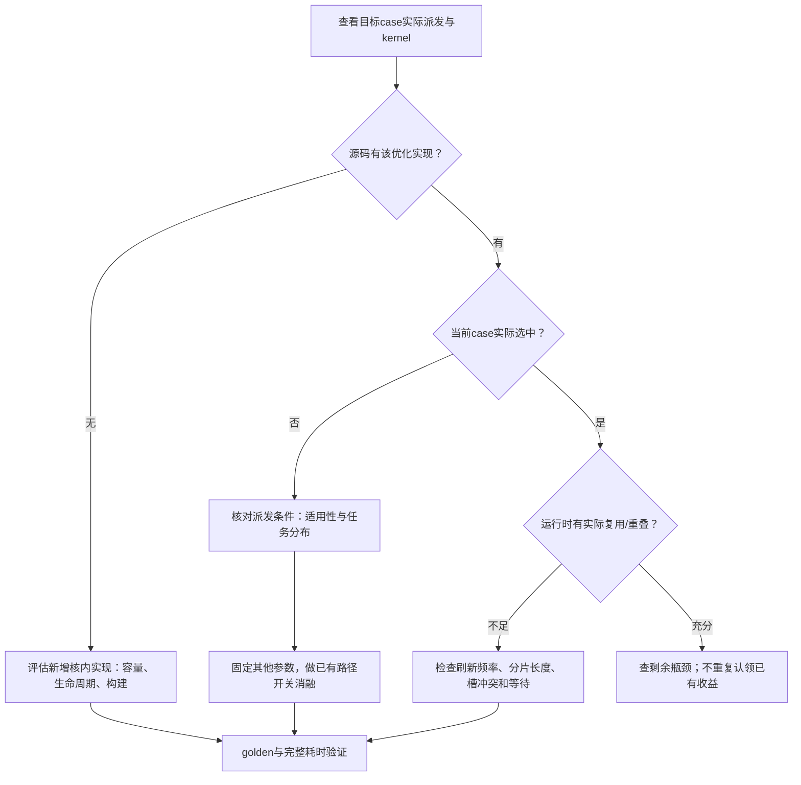

# FlashAttention常见优化技巧：条件、实现与验证

优化从[实际计算流程](semantics-and-decomposition.md)和[流水依赖](flow-to-pipeline.md)出发。每种技巧都区分原理、适用条件、代码是否已有、当前case是否选中、容量/同步代价和验证方式。本篇保留推导细节，具体M96/S112例子见[工程实例](example-mla-m96-s112-bsnd-paged-kv.md)。

## 适用范围：先迁移机制，再重算实例参数

| 知识 | 可迁移条件 | 当前MLA实例限定 |
|---|---|---|
| Q在L1/L0A驻留、Q/P分时复用 | 同核同Q跨KV重用；容量和最后消费者允许 | 前96维、18/24/21 KiB分区与五段D划分 |
| 分块、预取、PV分段消费 | 搬运/计算有可隐藏的等待，且并发数据放得下 | M96/S112、三槽、N256和事件顺序 |
| 在线softmax、核内S2归约 | softmax attention沿KV分块 | S2物理stride128、具体VF和FP32缓冲组织 |
| S2跨核拆分与加权FD | Q并行不足，拆分收益超过合并成本 | Host成本模型、FD16/FD8阈值和workspace布局 |
| mask直通和提前准备 | 可证明整个有效tile可见；有未隐藏开销 | 当前阅读源码未集成，需目标实现验证 |
| K/V同源、RoPE区让给P | 接口确实共享K/V，且旧区域已读完 | V=K前512维；独立K/V的FA不能直接套用 |

下文保留当前实例的完整数字推导。迁移时根据目标D/DV、dtype、头映射与布局重算容量、任务量和同步，不把实例参数当作FA默认值。

## 1. 先区分三种优化工作



模板定义、编译实例、运行时派发和实际有效执行是四层证据。仅搜索到`qcache`、三缓冲或某个VF，不足以判断它是否作用于当前case。反过来，源码已有优化也不代表没有派发优化空间。

当前M96阅读快照的Q96加载受`isFirstS2Loop`控制，匹配此实现的case已采用该布局；不能凭其他工程的策略名给它虚构Host开关。其他目标工程若同时有驻留/非驻留路径，应读取真实selector及编译/运行记录。

## 2. Q分块驻留：把重复搬运变成跨KV复用

### 2.1 先判断省的是哪一级搬运

同一Q块反复与不同KV块做QK时：

| 层级 | 驻留对象 | 可减少什么 | 不代表什么 |
|---|---|---|---|
| L1 | 完整Q块 | GM→L1重复读取Q | 不代表L1→L0A也消失 |
| L0A | 能放下的一部分Q特征 | L1→L0A重复装载这一部分 | 不代表K装载、剩余Q装载或PV消失 |

完整Q能放L1，未必能放L0A。当前M96×D576×2字节为108 KiB，超过本实现64 KiB L0A预算，因此选择每行前96维共18 KiB驻留。

### 2.2 同一Q的复用次数来自本核的实际任务

定义一个复用段j：同一核中，同一Q块的驻留内容从一次有效装入到下一次必须刷新之间的连续任务。T_j是这个区间实际参与的KV计算tile数；FD归约任务不计入。metadata记录如果跨多个Q块，要先按Q身份切开，不能把整条记录长度都算成同一Q的复用。

若每次缓存装载字节数为B_j，理论减少的该层Q装载字节为：

```text
saved_Q_bytes = sum_j max(T_j - 1, 0) × B_j
B_j = 实际对齐行数 × 驻留特征宽 × 输入元素字节数
```

当前满块B_j=96×96×2=18 KiB。同Q处理T个KV块时省`(T−1)×18 KiB`。未驻留时每轮Q装载108 KiB；驻留后首轮108 KiB、后续90 KiB。当T很大时Q这一层装载最多少约16.7%，不是HBM总流量或kernel耗时减少16.7%。

### 2.3 为什么仅看全局最短片段会错过机会

一种派发器可能要求所有FA片段都足够长才允许Q驻留。若只有一个短尾片，`min(T_j)`仍会很小，可能把大多数长任务的收益全部否决。

需要记录的分布包括：

| 指标 | 帮助判断什么 | 局限 |
|---|---|---|
| min/max、均值、分位数 | 短尾与多数任务是否差异很大 | 均值也可能被少量长任务抬高 |
| T_j=1或很短任务的比例 | 没有复用或复用有限的任务占比 | 按任务计数不等于按工作量计数 |
| 长任务贡献的KV tile/有效行工作量 | 候选能影响多少工作 | 不直接给出关键路径节省时间 |
| Q刷新次数、相同Q连续范围 | 理论复用是否被切换破坏 | 需与实际派发及代码刷新条件核对 |
| 每核任务/长度分布 | 是否存在拖尾或不均衡 | 块数相近仍可能有尾块和初始化差异 |

不能把`min`换成`mean`就宣称问题解决，也不能把某个实验的长度阈值写成默认启用条件。目标是形成派发候选并做开关A/B，保留同策略失败的shape。一个case变快并不证明新selector可全量启用。

### 2.4 驻留区和临时区必须联合建模

对于“一块驻留Q、两块临时Q，其中一块与P分时共享”这一布局，容量约束为：

```text
aligned_M × bytes × [resident_width + temp_A_width + max(temp_B_width, P_width)]
    + 其他实际占用 <= L0A可用容量
```

具体LoadData转置、NZ和尾块会改变实际足迹，不能只代入逻辑shape。当前地址如下，KiB为1024字节，区间左闭右开：

| L0A区间 | 使用者 | 满块大小 |
|---|---|---:|
| [0,18) | Q每行前96维 | 18 KiB |
| [18,42) | 两个128维Q临时段轮流使用 | 24 KiB |
| [42,63) | 两个112维Q临时段与PV的P分时使用 | 21 KiB |
| [63,64) | 未用 | 1 KiB |

```text
L0A地址：0             18                    42                  63 64 KiB
         | 驻留Q前96维 |  Q128临时区          | Q112 / P共享区     |余|
QK阶段： | 持续保留    | 两次使用，分段覆写   | 两次使用Q112      |
PV阶段： | 持续保留    | 本阶段不存P         | P装一次供两组PV   |
```

QK沿D按96+112+128+112+128覆盖576维；第一次Mmad初始化结果，其余累加。共享区的Q112最后读取结束且P-ready满足后才能装P；P最后读取结束后才能再次装Q112。共享使原本额外需要21 KiB的P不单独分配，L0A从84 KiB需求降至63 KiB。

扩大驻留宽度会挤压临时区，不是免费提高复用。更小M可能容纳更多驻留Q，但同时改变KV复用行数、任务数和Vector开销，必须记成联合设计。

### 2.5 核内伪流程与不变量

```text
每个QK任务：
    当前Q首次使用/必须刷新时，装入驻留部分
    遍历D分段：
        等L0操作数区域可覆写
        驻留段复用，其余Q段与对应K段由MTE1准备
        操作数就绪后Mmad，按段初始化/累加

后续PV任务：
    等两侧AIV的P到L1
    等Q112共享区域的旧读取结束
    P装入共享区一次，供两个N256结果块复用
    全部读取结束后才归还共享区
```

Q改变、batch改变或调度跳到不再共享的Q时必须刷新；源代码中的旧`Q_L0A_CACHE_COUNT`常量不能替代实际地址证据。跨核P-ready保证数据生产完成，不能替代本核L0A的覆写保护。

### 2.6 怎样验证驻留和派发优化

| 改动类型 | 固定项 | 必须观察的差异 |
|---|---|---|
| 启用已有驻留路径 | tile、分核/metadata、mask、输入、同步等 | 编译/运行记录确实从未选中变选中；结果及完整耗时 |
| 新增或改变驻留布局 | 其余机制尽可能固定；联动项显式列出 | Q段完整覆盖、地址预算、刷新和异步消费者 |
| 修改selector | 同一组路径实现；多代表shape | 每例派发状态、分片分布、正负收益和失败边界 |

先核验代码确实减少L1→L0A读取，再做成对稳定计时；没有MTE1关键路径证据时，不能把全部微秒精确归因为某类等待。当前M96/S112来源仍未提供Q96单项消融，不可用别的tile、实现或派发案例填补这条证据。

## 3. L1 KV/P复用：省容量才能保住预取

可迁移的原则是把生命周期结束的输入区交给后续中间量；本节具体的KV/P地址方案依赖K/V同源。满块先读K576到L1；QK结束后PV只读前512维V，原RoPE区域的生命周期结束，于是可用于P。

```text
槽相对地址：0                         112         126      133 KiB
QK输入：    | V/latent，512维          | RoPE64维   |预留    |
PV输入：    | V保留                    | P：96×112×2字节     |
```

P起点是固定`s2BaseSize*dVBaseSize`个输入元素，尾块也保留此起点；不能按尾S2紧凑数据量重算P地址。普通独立V的FA不能套这个方案省V输入。

**触发条件：** L1容量限制多槽预取，且有阶段结束后不再读的数据区。**改动：** 调整地址、布局与消费者关系，而非只把两个tensor指针设成相同。**验证：** 尾S2、跨页、P/V完整列覆盖、三槽周转和同步；只有容量省下不算性能通过。

## 4. M/S2联合分块与KV三槽预取

增大M提高一份KV服务的Q行数，但增大Q、P、输出累计和结果buffer。增大S2减少遍历次数，却增大每个KV/P槽、softmax工作区及操作数足迹。

L1应计入驻留Q，以及每个并发槽内同时存活的K、V和P的实际布局足迹；允许重叠的区域只计一次，独立K/V必须分别计入。当前K/V同源且P复用旧RoPE区的结构约束为：

```text
M×D×bytes + 3×S2×(DV+M)×bytes <= L1预算
M96、D576、DV512、2字节：
S2=112 → 507 KiB；S2=128 → 564 KiB，超过512 KiB。
```

S2容量上界约113.4，按当前16元素粒度得到112；112不是32对齐。UB行stride128、搬运字节对齐是另外的约束。

**触发条件：** MTE2等待下一KV、S2循环过多、Q行复用不足。先确认预取是否已存在，再判断晚发起是地址计算慢、槽未释放还是带宽问题。

**候选：** 更早安全发MTE2、页内合并、联合M/S2/槽数调参。若需减少三槽才能放更大S2，必须重新编排流水并计入损失的预取窗口，不能照搬旧`loop%3`逻辑。

**反例：** 短KV只有一块、任务发射已主导、旧PV拖住槽。增加buffer不解决生产者迟到，也可能超预算。

## 5. PV按输出列分段与P一次装载

本实现DV512拆为256+256。P21 KiB一次装入L0A，两组PV复用；每个N256沿S2分64+48做两次Mmad。各组完成即FIX/AIV消费。

| 约束 | 当前满块占用 | 改分段时的影响 |
|---|---:|---|
| L0B的V64×256×2 | 32 KiB | N更大会超过当前操作数槽 |
| L0C的96×256×4 | 96 KiB | N512结果192 KiB装不进单128 KiB槽 |
| 单AIV的48×256×4 | 48 KiB | 两个接收槽占96 KiB |
| 单AIV输出累计48×512×4 | 96 KiB | 不能随接收分段而丢失另一半累计 |

**触发条件：** FIX等接收槽、Vector消费落后、整块结果到达太晚。**候选：** 调整分段或优化ProcessVec2热点；联动接收stride256、累计stride512及flags。**代价：** 分段更细增加交接，分段更粗增加容量。当前已做N256时，不能把它再次当作新增改动。

## 6. 在线归约、VF组织与首末特化

语义必要的是统一max基准、sum和输出同尺度更新、完整有效范围及最终归一化。性能组织包括first/last编译特化、寄存器分组后水平归约、按N256结果到达即消费、FP32状态常驻。

当前S2=112在物理128列内计算；可理解为64+48有效位置加16无效位置，实际VF载存布局以代码为准。两组先逐lane Max/Add再水平reduce可减少重复归约，但本库未独立测此组织的收益。

**触发条件：** Vector明确处于关键路径或对FIX形成反压。**改法：** 定位到实际VF、cast/排列或输出更新；先核对目标arch35的Reg/MicroAPI构建契约。**验证：** 后续tile更大max、尾列、空行、后256列、Out和LSE。只测随机平均分布可能掩盖错公式。

## 7. 带mask路径的全可见直通与提前准备

无mask编译特化与带mask算子内部某tile全可见是两层选择。当前BSND/BBND无mask例子已经没有mask工作；本地M96源码尚未集成教程所述带mask全可见直通/当前mask提前准备。

```text
原次序：等QK → 准备mask → 等mask可读 → 带mask softmax
候选：  判断当前tile所有有效行的可见性
        ├─ 全可见：等QK → 无mask softmax（仍屏蔽padding）
        └─ 需mask：先发当前mask准备 → 等QK → 等mask可读 → 带mask softmax
```

**触发条件：** 右下因果、长KV短Q、多数tile全可见，并存在未隐藏的mask/Vector开销。**约束：** 分支判断覆盖该AIV所有有效行、pre-mask、尾块；不能凭“不是最后一块”判定全可见。提前的是当前mask，不能覆盖旧消费者正在使用的槽。

**验证：** 全可见、部分可见、边界、尾S2、空行AIV；同时看Vector活动与完整kernel耗时。Vector少做的工作可能本来已与Cube重叠，不能把活动时间差直接当加速。该候选未在本次重新上板，不将外部教程数字混入当前例子。

## 8. S2跨核拆分与FD成本

Q方向任务不足、KV长时，S2拆分增加有效核数；代价是FP32分片写回、读取、统计权重、输出归约及同步。粗略判据为：

```text
不拆分FA时间 - 拆分FA时间
    > 分片写回 + FD读回/归约 + 新增同步成本
```

调度器允许FD不等于强制FD；读metadata和实际selector。Q方向已有足够M块、KV较短或分片太多时，更多FD未必有益。

当前parts≤6时FD按16行、更多parts按8行。FD16每AIV用到248 KiB预算，16行权重内部仍按最多8行chunk处理，保留原分片stride。不能只把VF行数参数改成16就认为后8行被处理。

**有效消融：** 保持同一设备kernel，Host分别生成合法split/no-split metadata，再各自验golden和完整耗时。禁止只清split metadata的FD标志，也不能把两种调度时间差解释为纯FD耗时。

**统计量紧凑存储：** 可减少字节，但消费者可能增加广播/重排。先联动生产消费格式，再计算总成本；不能只按搬运字节判断。最后AIC到最后AIV的尾段还含末轮Vector与同步，不直接等于FD。

### 8.1 token-wise SFA先优化离散gather链

`SparseFlashAttention` 的工作量由每行实际选择的K个token决定，不是完整S2。其AIV
先执行 `sparse_indices/block_table → K512+RoPE64` 离散读取，再经workspace GM和
AIC Nd2Nz进入L1。若trace显示V0位于关键路径，优化顺序应围绕这条链，而不是先扩大
Cube tile：

| 当前机制/信号 | 候选方向 | 门禁 |
|---|---|---|
| 每两个index后穿插页表和offset读取 | 连续index按cache line批量读到局部数组 | 保留原pair消费、`-1`尾部且无spill |
| 两个KV地址可由一条stride表达 | `DataCopyPad blockCount=2`合并搬运 | 重复地址、超大stride和单尾token必须fallback；倒序pair可同步重排K/V。split-G下V0未必仍在关键路径，应做按shape选型而不是无条件合并 |
| UB每16行写一次workspace | 调整聚合批次或更早发MTE3 | UB容量、三槽目标不能被旧消费者占用。每2行一刷会把UB→GM握手放大约8倍 |
| PA页表读取反复 | 页号/页内偏移局部化或小批量读取 | 跨页和非连续0轴stride |
| S2足迹增大但K不变时变慢 | 改善index局部性或局部地址排序 | K/V必须同步置换；归约顺序变化重验精度，排序成本计入 |
| G≤64时增加head几乎不增时 | 保留一份gather服务G个head的M轴组织 | 仅N2=1且共享稀疏选择 |
| G>64进入split-G后阶跃 | 评估阈值附近任务分布和同步 | 单AIC的72 KiB Q与三槽L1预算是硬约束 |

当前baseline已经实现两token搬运、16行UB聚合、三槽流水、P覆盖K-rope、K/V同源、
尾S2三档VF和split-G；源码存在不等于当前case仍有这些方向的增量收益。完整实现、
内存推导和关键片段见
[token-wise SFA实例](example-sparse-flash-attention-tokenwise-mla.md)，metadata批量
读取模式见[GetValue优化](getvalue_cacheline_batching_design.md)。

调试时先看V0是否还在关键路径：UB聚合批次决定workspace握手次数；pair合并搬运
只在stride合法时成立，split-G后更宜按shape选型。Q跨S2驻留与`IterateBmm1SFA`
的L1A释放配对，只改加载侧会挂死，不能当独立开关。

### 8.2 G维协同切分：4个AIV共享gather结果

token-wise SFA中，同一query token的G个head共享同一份top-k KV。当`G>64`、单AIC的
M轴或L1容量无法承载完整G时，可以把相邻两个AIC组成逻辑工作组，各计算一半head；
两个AIC配套的4个AIV协同生产同一份KV块：

```text
4个AIV：top-k行四分 → 写同一组三槽workspace GM
                         ↓ 全AIV flag 15到达同步
两个AIC：各自读取完整KV块 → 各自L1 → 分别计算前/后半G
```

关键实现点：

- `aicIdx >> 1`让相邻两个AIC共享workspace基址，4个AIV写互不重叠的行区间；
- flag 15是全AIV集体到达，不是4核局部barrier；无任务AIV也按`maxS2LoopCnt`空跑
  相同次数，闲置AIC则直接返回；
- barrier只保证共享GM写完；之后仍由每个AIV的本地cross-core事件通知配对AIC；
- 两个AIC都读取完整KV，但随机gather只发生一遍，避免重复读取top-k。

**适用条件：** `N2=1`、同一token的所有G个head共享稀疏索引，且G已超过单AIC容量。
它主要解决“切G后怎样继续共享KV”的问题。成本是全AIV同步、两份Nd2Nz、逻辑query
并行度减半；闲核越多、各核S2轮数越不均，barrier尾部空等越明显。

**证据边界：** G=128的BSND与TND/PA真机case已证明该机制功能正确；G扫描观察到进入
split-G后的耗时阶跃。目前没有将“4-AIV共享gather + 全AIV同步”与“两个AIC各自完整
gather、无跨AIC同步”直接A/B，所以不能声称这套机制净加速多少。它是一个已实现、
值得复用的优化思路，也是后续可以通过组内同步、分片就绪通知或按K选择重复gather
进一步优化的对象。

## 9. 地址计算、布局和启动优化

| 信号 | 候选方向 | 必须保留的边界 |
|---|---|---|
| 热循环反复页表/地址运算 | 不变量外提、局部化、合法批量读取 | 分页边界、动态长度、每任务Q/S2身份 |
| 连续特征被拆成多次搬运 | 合并完整特征读取或重排搬运 | 目标K的D维完整覆盖；MLA例子中不要遗漏RoPE |
| 短kernel启动/metadata占比高 | 避免重复初始化、按语义减少无用启动工作 | 计时包含范围、空输出/LSE初始化语义 |
| 编译期已知分支仍在热循环 | 针对路径特化 | 不把所有runtime长度/FD/LSE都扩成模板组合 |
| 同名C++符号在宿主加载时冲突 | 内部符号隐藏、公共C ABI显式导出 | CLI成功不能代替实际宿主集成验证 |

布局变化必须计算上游转换和下游消费的总账。条件性的KV L2缓存提示与Q在L0A驻留作用于不同对象/层级；某工程把两者绑在一个selector中，不等于硬件天然禁止共存，拆开策略仍需验证。

## 10. 把候选写成可执行实验

```text
case实际路径、编译/派发状态与任务分布
    → 瓶颈节点和等待对象
    → 已有实现未选中，或已选中但仍有具体不足
    → 一项派发/核内候选及容量、同步不变量
    → 固定变量，保留不适用shape或失败条件
    → 独立golden + 完整耗时 + 机制证据
```

没有trace时可以先提出有shape和源码支持的假设，不虚构热点。没有稳定收益时记录正确但未更快；单例改进记录局部适用；同策略的退化不能藏在平均值中。
