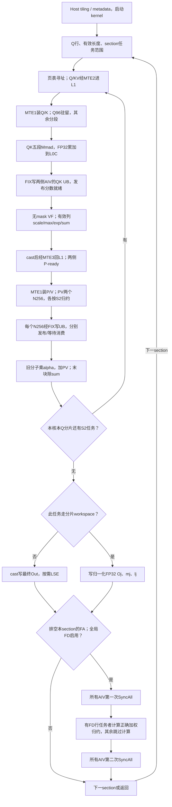

# 例子：BSND查询与分页BBND缓存的MLA

本篇继续使用当前AscendC直调工程的M96/S112实现，具体讲解BSND输入/输出、分页BBND缓存、无mask这一条路径。M96表示每块96个查询/head行，S112表示每块112个KV token；文件名按含义命名，不以布局枚举数字作为阅读入口。

阅读顺序：路径选择 → 完整计算图 → 逐段源码解释 → 三轮调度 → 优化触发表 → 三个case推演 → 完整容量表。公式推导见[算子语义](semantics-and-decomposition.md)，通路依赖见[流水编排](flow-to-pipeline.md)，技巧的适用条件见[优化篇](common-optimizations.md)。

## 1. 先判断 case 是否走这张图

本例名称直接表达数据布局和计算条件。BSND各轴依次为batch、query序列、head、特征；分页BBND各轴依次为物理页、页内token、KV头、特征。FD和LSE另由运行时控制。

| 项目 | 这条路径 |
|---|---|
| Q / Out | BSND：Q[B,S,H,576]，Out[B,S,H,512] |
| KV | PA_BBND：[物理页数, block_size, 1, 576]，单 KV 头 |
| mask | 0，无 mask；仍处理有效长度、尾块和 padding |
| dtype | FP16/BF16 同一流程，cast/舍入分别验证 |
| 基本块 | M96、S2=112、D576、DV512 |
| FD / LSE | 运行时决定，不能由图名判断是否执行 |
| 源码身份 | 本目录sources中的M96/S112源码阅读快照；DAV_3510，来源验证设备36 AIC/72 AIV |

这不是所有 MLA 的默认路线。实际输入若为TND/PA_NZ/mask3，应选对应主图，并保留本篇共享的QK/PV/S2归约分析，只替换行索引、页内搬运和mask段。目标若不是DAV_3510，内存预算和API重新核验。

本篇没有新增NPU性能实验。已有两条长KV通过用例是TND/PA_NZ/mask3，**不能据此宣称本张BSND/BBND/mask0图已经单独通过精度/性能验收**。

## 2. 完整计算图：从任务分配到最终输出

下图直接以Markdown中的Mermaid表示。节点写明动作、数据和通路；箭头表示依赖/程序控制，不表示等比例时间：



这是逐任务语义图；真实发起顺序是当前QK配上一任务PV，第4节单独说明。“此任务走分片workspace”的实现字段是`isS2SplitCore`；“全局FD启用”来自metadata header。不能拿每核是否有归约工作替代全核一致的同步开关。

| 流程段 | 对应源码函数 | 要关注的依赖 |
|---|---|---|
| 分核、行范围和首末tile | Host SectionStreamK；Init、CalcParams | 元数据、有效范围、任务身份 |
| 页表寻址和预取 | CopyKeyAndRopeTile、IterateBmm1Load | GM→L1搬运和槽释放 |
| Q/K分段装载 | Mm1MatmulK | 驻留刷新、MTE1与M的操作数交接 |
| QK结果交给AIV | IterateBmm1、ProcessVec1 | FIX完成、旧QK UB消费确认 |
| softmax与P返回L1 | ProcessVec1Nd、Vec1PostProcess | 有效列、统计状态、两侧P-ready |
| PV和分段结果消费 | IterateBmm2、ProcessVec2 | L0C可用、PV UB可覆写 |
| 核内输出更新 | MlaStreamUpdate | 当前任务alpha、末块sum |
| 最终/分片写出 | CopyOutAttentionOut | dtype、输出布局、Oj是否已归一化 |
| 跨核归约与section切换 | FlashDecode | 全局同步、完整分片、业务UB复用 |

## 3. 每段到底做什么，哪些地方可能慢

### 3.1 先看分配了多少有效工作，不先改 Cube

读 [Host metadata][host] 及 [kernel 的 Init、CalcParams、ExecuteTask][kernel]。Q行在本路径按 `m=s×H+h` 展开；每个batch有`ceil(S×H/96)`个M块。长度、首末S2、尾M、每侧AIV行数由runInfo描述。

**为什么需要：** 启动36个核不代表36个核都有有效FA任务。metadata指定每核区间，允许跨M边界；某一Q块的KV又可能拆给多个核，后续需要FD。

**触发观察：** 长KV但大多数核没分到矩阵任务，先看S2调度；短KV只有一两轮，先看初始化、任务发射和排空。读取metadata的有效区间、每核任务数/分片数；别只根据核间总时长差推断不均衡。记录主kernel计时是否排除了Host/AICPU metadata生成。

**本模板已有：** SectionStreamK允许按成本选择S2拆分。只有实际未拆或拆分粒度不合适时才形成新候选，不能把“启用FD”当成所有case都有效的开关。

### 3.2 KV寻址和GM→L1搬运

读 [Cube 的 CopyKeyAndRopeTile、CopyQueryAndRopeTile、IterateBmm1Load][cube]。逻辑token先得到逻辑页与页内偏移，再经block_table定位物理页。本路径从GM的页内ND数据搬到供Cube读取的L1布局；BBND连续特征并不意味着整段KV物理页连续。

**为什么需要：** 输入可能分页、跨页、带尾块，搬运必须覆盖有效K576。该算子的V就是逻辑K前512维，QK后复用这份L1数据，PV阶段没有第二份V的GM读取。此约定不能推广到独立K/V attention。

**触发观察：** 等KV就绪时Cube停顿、跨页后搬运变碎、热循环重复页表寻址，才考虑页内搬运合并、地址不变量外提或预取时机。需要同时看调用参数、页边界和真实MTE2等待；MTE2活动长但被完全隐藏时，局部减载未必改善总时长。除非用户任务允许且计入转换成本，不把更换上游cache布局当作免费改法。

**容量约束：** L1单Q块108 KiB；KV/P三槽各133 KiB，总507 KiB。满块每槽先存V112 KiB + RoPE14 KiB；QK读完RoPE后，后部21 KiB给P使用。尾块P起点仍按固定S2基本块112计算。三槽都活跃时不能盲加第四槽。

### 3.3 QK五段、Q驻留和L0装载

逻辑计算是`Q[96,576]×Kᵀ[576,112]`。读 [Mm1MatmulK][cube]，同一结果依次累加五段：

| 特征列 | 段宽 | L0A地址KiB | 同Q后续KV任务是否重搬Q |
|---|---:|---|---|
| [0,96) | 96 | [0,18) | 否 |
| [96,208) | 112 | [42,63) | 是 |
| [208,336) | 128 | [18,42) | 是 |
| [336,448) | 112 | [42,63) | 是 |
| [448,576) | 128 | [18,42) | 是 |

完整Q108 KiB放不进64 KiB L0A；驻留18 KiB + 临时24 KiB + Q112/P共享21 KiB=63 KiB。L1完整Q驻留减少GM→L1读取；L0A局部Q驻留减少L1→L0A读取，两者分开计量。同Q处理T个KV任务时，Q96缓存相对重复装载少`(T−1)×18 KiB`，不是整个Q不再装载。

**触发观察：** 同Q的KV轮数多且MTE1准备暴露在关键路径，才考虑驻留宽度或分段调整。先确认源码是否有实现、当前case是否选中及复用段是否足够长。本例匹配的M96实现已按首S2任务装入Q96，重复启用同一机制没有增量；驻留宽度或分段仍可另作候选。其他工程即使有驻留实现，也可能因派发条件未选中，需按[Q驻留选型](common-optimizations.md)继续分析。T=1时没有跨KV重复装载可省。

**边界：** Q96和P地址不同，可以同时存在；Q112和P地址相同，必须等旧读结束再覆盖。可能与QK_i末段交叠搬入的是已就绪的P_(i−1)，P_i仍依赖自己的QK_i和softmax_i。A/B共用的Mutex与连续L0B游标保护异步读写，不可凭代码调用结束删除wait。

### 3.4 分数交给两个AIV，生成PV可用的P

读 [ProcessVec1、ProcessVec1Nd、Vec1PostProcess][vec]。FIX把满M96拆给两侧AIV，各48行。每侧QK UB为48×128 FP32=24 KiB，逻辑有效列最多112；padding不能进入max/sum。

对当前tile得分x，先scale，再维护：

```text
m_new = max(m_old, max(x))
alpha = exp(m_old-m_new)
P = exp(x-m_new)
l_new = alpha*l_old + sum(P)
```

P还没有除完整分片sum；转为FP16/BF16，经MTE3写L1后，Cube才可用MTE1读它。max/sum、输出分子保留FP32。sum/max按`mloop%3`保存Q块状态，alpha按`loop%3`保存KV任务状态。

**两个等待不要混淆：** AIV先等QK结果就绪，读完再归还QK UB；AIC的PV另等两侧P-ready。一个AIV无有效行时仍须发出协议要求的通知，否则另一端会一直等。

**触发观察：** 若PV经常等待P，回看softmax、cast/P写出和AIV自身排队，不直接认定MTE1慢。若QK的FIX因旧UB未释放而阻塞，回看旧分数的Vector消费者。只有相应路径确有热点，才考虑VF组织、减少重复中转或调整交错。

**本图无mask：** 不能选择“全可见mask跳过”优化；该工作已经被编译移除。mask3兄弟路径才有mask准备/直通候选，而且尾列有效性仍需保留。

### 3.5 PV为何拆两组256列，结果为何分两次交接

逻辑计算是`P[96,112]×V[112,512]`。读 [IterateBmm2、FixpipeMm2PartialN][cube]：P21 KiB只装入L0A一次；V的输出列拆为256+256，每组沿S2再拆64+48，共四次Mmad。

`V64×256×2=32 KiB`刚好占一个L0B槽；`96×256×4=96 KiB`放入128 KiB L0C槽；FIX后每侧AIV收到48 KiB。AIV可在后半输出计算期间更新前半，输出分子行stride仍为512。

**触发观察：** 若FIX等PV UB释放，检查ProcessVec2是否跟不上；若PV算完前256列仍等待很久，区分L0C可用、P-ready、L0B操作数准备三个原因。N块改小会增加交接次数；改大则可能超L0B/L0C/UB预算。当前N512整块FP32结果192 KiB装不进一个128 KiB L0C槽，所以不能只把循环次数从2改成1。

**本模板已有：** N256分段消费、P一次装载、L0B双缓冲。优化需证明哪一处仍有可改善的等待，而不是再次列出这些技巧。`lastMatmulWasPv_`处理连续PV边界，不能当无用状态删掉。

### 3.6 核内在线归约和S2循环

读 [ProcessVec2、MlaStreamUpdate][vec]：`A_new=alpha×A_old+PV`；首tile不读旧A，末tile才`O=A/l`。每侧48×512 FP32输出分子为96 KiB，跨当前分片所有KV块保留。

**为什么需要：** 新tile可能产生更大max，旧sum和旧输出都要换到新指数基准。分别归一化每个tile后直接平均不能恢复正确attention。延后执行的PV必须使用自己任务的alpha，不能读最新tile的alpha。

**触发观察：** S2过小导致max/sum、输出更新与通知执行过多；可以考虑较大tile减少轮数，但必须同时算L1、UB和流水槽预算。这里固定M96三槽时S2=128需要564 KiB L1，超512 KiB；可探索联合改变M/槽数/生命周期，属于组合实验。不能在保持全部结构时单改112→128。

**验证：** 让后续tile出现更大max，检查Out和LSE；只测LSE会漏掉输出重缩放错误。改归约顺序时两边独立验golden，不要求逐位相同。已有[数学反例][reduce-validation]可作机制验证，不能替代目标dtype上板精度。

### 3.7 最终输出与分片输出不是同一种写回

读 [CopyOutAttentionOut][vec]。不经分片workspace的任务cast后写最终BSND Out；分片路径把**已除局部sum的FP32 Oj**以及mj/lj写workspace。LSE按运行时开关处理，格式为[B,H,S]。

**触发观察：** 短case可能由cast、写回、LSE和初始化主导；分片很多时workspace交通可能显著。需要按真实输出布局和是否启用LSE采样；不能关LSE再与原case比较来宣称优化。也不能把Oj改为低精度以省字节却沿用旧精度结论。

### 3.8 多核归约、两次同步和排空

读 [kernel::FlashDecode][kernel] 和 [FD实现][fd]。全局FD启用时所有AIV先SyncAll，有归约行者取各片结果并计算：

```text
m = max_j(mj)
t_j = exp(mj-m)*lj
w_j = t_j / sum_j(t_j)
Out = sum_j(w_j*Oj)
LSE = m + log(sum_j(t_j))
```

然后所有AIV第二次SyncAll，再继续后续section；无归约行者只跳过计算，不能跳过外层barrier。主FA流水先排空，末轮PV/输出更新不是可省掉的“收尾空洞”。

**触发观察：** Q块并行不足且KV长，增加S2并行可能值得支付FD成本；Q块已经足够则检查过度分片。每侧FD16布局保留前120 KiB CV区域，业务区用到248 KiB上限；parts≤6时16行，否则8行，不能无预算提高到32行。

**有效对照：** 固定设备kernel，允许/禁止S2拆分时重新生成各自合法metadata。不能保留split metadata只清FD开关。总耗时差反映并行FA与FD的共同变化，不是纯FD耗时；最后AIC到最后AIV的尾段也包含末轮Vector及同步。

## 4. 把长图放回三轮真实发起顺序

这段同一Q块的例子包含三个KV任务i=0,1,2；`PRELOAD_N=2`使PV落后QK一轮。AIC/AIV各自顺序如下，列之间不是等比例时间：

| 轮次 | AIC发起顺序 | AIV执行顺序 | L1三个槽 |
|---|---|---|---|
| 0，启动 | 预取KV1；补Q/KV0；QK0 | 等QK0；softmax0；P0写L1 | 槽0用于任务0，槽1装任务1 |
| 1 | 预取KV2；QK1；PV0 | softmax1；update0 | 槽2预取，槽1当前QK，槽0上一PV |
| 2 | QK2；PV1 | softmax2；update1 | 槽2当前QK，槽1上一PV |
| 排空 | PV2 | update2；末块写出 | 任务2全部消费者完成才释放 |

```text
MTE2：GM→L1准备Q/KV；KV_(i+1)可与当前运算交叠
MTE1：同一通路装Q/K和P/V；Q96跨KV留存，临时区需等旧读结束
M：   QK0 → QK1 → PV0 → QK2 → PV1 → PV2
FIX： 分别输出QK和两个N256结果；等目标UB消费者释放
V：   softmax0 → softmax1 → update0 → softmax2 → update1 → update2
MTE3：P回L1；分片结束后Out/统计量写GM
```

这是依赖和发起顺序示意；六条通路的[完整Markdown泳道表](flow-to-pipeline.md)包含操作数和结果搬运。QK/PV共享M，softmax/update共享各自AIV的V，不能从分开的框推断同时满速执行。

分析一次wait，沿箭头反查三件事：**等待谁生产？生产者是在计算、搬运还是又等旧buffer释放？把这段提前后容量和最后消费者是否仍允许？** 找到闭合原因后再选优化，wait长不等于该wait应删除。

## 5. 来了一个 case，按这些信号选择第一项实验

先区分`无实现`、`有实现但本case未选中`、`已选中但复用不足`、`已有效执行`和`路径不适用`；不能只搜索到源码就停止选型分析。shape提供候选方向；实际热点和相对baseline的增量决定是否实施。

| 触发信号 | 定位节点/函数 | 优先取证 | 一项候选与验收观察 | 放弃/转向条件 |
|---|---|---|---|---|
| 长KV、有效FA核少 | 分核，SectionStreamK | metadata每核范围、parts、活动核 | 合法调整S2拆分，比较完整kernel及golden | baseline已合理拆分，或FD抵消收益 |
| Cube等下一KV | KV预取，IterateBmm1Load | MTE2发起时间、分页粒度、槽释放 | 更早安全预取或合并页内搬运；等待和总耗时下降 | 等待实际来自上一PV未释放槽 |
| 同Q多轮且MTE1等待突出 | QK装载，Mm1MatmulK | Q缓存命中、每轮LoadData与L0容量 | 先核对selector；未选中可做派发消融，无实现则设计驻留；计量对应层字节 | 当前case已有效复用、T=1，或新分段挤掉P |
| PV等P-ready | softmax/P写回，ProcessVec1 | 分数就绪、VF、cast及P写出时间 | 改对应热点或任务交错；P-ready提前且总耗时改善 | P已足够早，瓶颈在PV其他依赖 |
| mask工作多且大多全可见 | mask准备，带mask兄弟路径 | 实际命中率、边界和padding | 全可见直通/当前mask提前准备 | 本图mask0；候选源码/证据不足时仅提出实验 |
| FIX等PV接收槽 | 结果消费，ProcessVec2 | Vector输出更新时长、每段通知 | 改更新热点或N分块组合；缩短反压 | 新增交接更慢或容量超限 |
| S2轮数很多、每轮Vector成本突出 | S2递推，tile选择 | 总tile数、多层预算 | 联合M/S2方案减少循环；比较全部阶段 | M96三槽下S2=128超预算 |
| 长尾和workspace流量高 | 分片归约，FlashDecode | 分片数、AIV归约任务及阶段时间 | 减少不必要分片或调整归约行批次 | 只观察到整体尾段，尚不能归因FD |
| 短case启动占比高 | 启动/排空，Init | metadata、launch、主kernel分段 | 在语义允许时减少重复初始化/启动工作 | 已有kernel足够紧；长KV驻留技巧无重复量可省 |

## 6. 三个 case 推演：同一张图不能给出同一个优化

以下是**设计推演，未运行性能测试**。统一BSND/BBND、mask0、H96、M96/S112；以36 AIC为资源假设，每batch任务数单独计算，真实执行以metadata为准。

| 输入 | shape能直接算出的事实 | 第一检查与条件候选 | 明确不应做 |
|---|---|---|---|
| B1/Q1/KV64 | 1个M块，只有1个KV tile | 看启动/尾S2及实际矩阵效率；有明显初始化热点才优化该段 | 没有跨KV复用，不能宣称Q96驻留省重复量；不机械拆KV |
| B1/Q8/KV128000 | 8个M块，每块1143个KV tile | 先看metadata是否只有8核FA；若是，测试合法S2拆分；若已36核有效，转KV预取、Q装载、P-ready或结果消费等待取证 | 不重复“开启已有FD/Q驻留”；不套mask3优化 |
| B1/Q36/KV128000 | 36个M块，Q方向已有36份并行任务 | 先看是否仍产生不必要FD及核间分配；无问题再看稳态搬运/Vector | 不能因KV长就认定继续加分片必快 |

历史约4.33×的调度A/B来自另外两条TND/PA_NZ/mask3长KV用例，仅说明“Q并行不足时拆S2”的机制有实测支持，不能填写成表中BBND用例的预测加速比。

## 7. 怎样扩展到其他长图

保留这篇主链，只为影响选型的分支补差异：mask3重点解释可见性和mask流水；PA_NZ重点解释页内搬运/特征块寻址；TND/NTD重点解释行索引、输出地址和连续性；FD重点解释parts/行批次/阶段预算。FP16/BF16复用流程，在cast、误差和验收处分别说明。

不要把所有图重复抄一遍，也不要只留“检查搬运、注意同步”的原则。每张选中的图最终应能定位到**函数、buffer、等待对象和一项可证伪实验**。缺少源码或性能证据时保留明确的待核对项，仍可完成shape与容量推演，不必先重写一个串行kernel。

## 8. 完整容量表：把数字从源码表达式推出来

本节所有KiB均为1024字节，地址区间左闭右开。L1/L0按一个AIC计，UB按每个AIV计。FP16/BF16输入元素2字节，矩阵结果和统计累计4字节。改变M、S2、DV、dtype或结果分段，都要重新计算。

### 8.1 L1：完整Q与三个KV/P槽

| 区域 | 地址KiB | 字节表达式 | 大小KiB |
|---|---|---|---:|
| Q单槽 | [0,108) | 96×576×2 | 108 |
| KV/P槽0 | [108,241) | 112×(512+96)×2 | 133 |
| KV/P槽1 | [241,374) | 同上 | 133 |
| KV/P槽2 | [374,507) | 同上 | 133 |
| 剩余 | [507,512) | 预算减使用量 | 5 |

```text
L1：0          108            241            374            507 512 KiB
    | 完整Q    | KV/P槽0      | KV/P槽1      | KV/P槽2      |余|

一个满槽在QK前：| V/latent 112 KiB | RoPE 14 KiB | 预留7 KiB |
一个满槽在PV前：| V/latent 112 KiB | P 21 KiB              |
```

608是512+96的容量规划，不是输入特征从576改成608。P可以覆盖RoPE的前提是原RoPE最后读取结束，不是两者字节数接近。

### 8.2 L0A、L0B和L0C

| 区域 | 地址KiB | 实际用途 |
|---|---|---|
| L0A驻留 | [0,18) | Q[每行,0:96]，跨当前Q的KV任务复用 |
| L0A临时Q128 | [18,42) | 先装特征[208,336)，后装[448,576) |
| L0A临时Q112/P | [42,63) | Q[96,208)、Q[336,448)和P分时使用 |
| L0B槽0/1 | [0,32)、[32,64) | K/V分段轮换；游标跨QK/PV延续 |
| L0C槽0/1 | [0,128)、[128,256) | QK或N256 PV结果；等FIX读完后复用 |

满块K96×112×2为21 KiB，K112×112×2为24.5 KiB，K128×112×2为28 KiB，均能放32 KiB L0B槽。PV的V64×256×2正好32 KiB；QK逻辑结果96×112×4为42 KiB，单组PV结果96×256×4为96 KiB。

L0C槽容量按最大结果而非只按QK设置。把它拆为64 KiB小槽会装不下当前PV。源码保留的一些旧常量/注释不是运行时地址表，优先读实际索引与数组长度。

### 8.3 FA阶段：每个AIV的UB

对应[Vec的UbLayout][vec]，满M96时每侧48行：

| 区域 | 地址KiB | 大小/用途 |
|---|---|---|
| PV前256列结果 | [0,48) | 48×256 FP32 |
| PV后256列结果 | [48,96) | 48×256 FP32 |
| QK结果 | [96,120) | 48×128 FP32，逻辑有效列≤112 |
| 输出分子累计 | [120,216) | 48×512 FP32 |
| P staging | [216,228.25) | 49×128×2字节，含VF布局额外行 |
| mask双槽 | [228.25,240.25) | 2×6144字节；无mask特化不执行对应工作 |
| sum三槽 | [240.25,241) | 3×256字节 |
| max三槽 | [241,241.75) | 3×256字节 |
| exp三槽 | [241.75,242.5) | 3×256字节 |
| LSE staging | [242.5,244) | 1.5 KiB |
| FD sum/max共用staging | [244,246) | 2 KiB，轮流使用同一地址/Mutex |
| softmax临时区 | [246,246.5) | 0.5 KiB |

合计246.5 KiB，相对本实现248 KiB检查上限仅余1.5 KiB。无mask不等于可直接压缩静态地址布局并取消所有占位，仍要检查偏移契约。

不能按P逻辑48×112×2缩小P staging，也不能把112逻辑列当成128有效列。旧注释中的mask“2×4K”、统计“2×256B”与当前数组表达式不同，以表达式为准。

### 8.4 FD阶段：业务UB复用，但CV区保留

对应[FD的InitBuffers16][fd]。parts≤6且按16行处理时：

| 区域 | 地址KiB | 大小依据 |
|---|---|---|
| 保留CV结果区 | [0,120) | FA的QK/PV交接区域 |
| sum双槽、max双槽、权重 | [120,135) | 5×(6份×16行×8个FP32)=15 KiB |
| Oj输入槽0 | [135,167) | 16×512×4=32 KiB |
| Oj输入槽1 | [167,199) | 32 KiB |
| 加权累计 | [199,231) | 32 KiB |
| 转换后输出 | [231,247) | 16×512×2=16 KiB |
| max临时区 | [247,247.5) | 两个句柄共享0.5 KiB |
| LSE临时区 | [247.5,248) | 0.5 KiB |

统计量每行的8个FP32是搬运/广播格式，不是8个不同的分母。FD16达到248 KiB上限，内部权重计算仍按最多8行调用[权重chunk VF](sources/mla_fd_scale_chunk.h)，保留完整分片stride。

更多parts走FD8：前120 KiB保留，统计区5×6 KiB，三块FP32输入/累计各16 KiB，输出8 KiB，小临时区3×256字节，最高地址206.75 KiB。FA与FD分阶段使用业务区，所以峰值看各阶段最大值，不把246.5与248相加；也不能省掉允许阶段切换的同步。

## 来源文件的使用范围

`sources/`是逐字复制的6个关键源码文件，按定位到的函数读取。它们用于核对本篇涉及的状态、地址和同步，未打包依赖头与构建工程，不是独立可编译模板。模型可据此在目标工程实现，无需照抄整个kernel。是否可编译、Reg/VF可见域和数值行为仍由目标SoC/SDK与实际构建验证。

[host]: sources/mla_tiling.cpp
[kernel]: sources/flash_mla_with_kvcache_kernel.h
[cube]: sources/flash_mla_with_kvcache_block_cube.h
[vec]: sources/flash_mla_with_kvcache_block_vec.h
[fd]: sources/flash_mla_with_kvcache_block_vec_flashdecode.h
[reduce-validation]: scripts/verify_math.py
