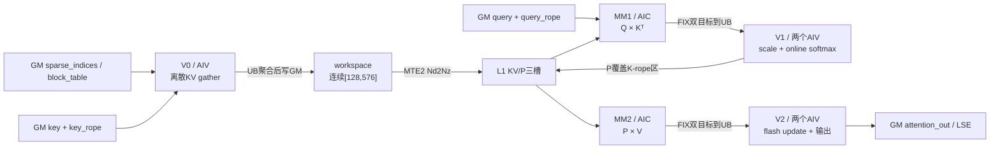

# 例子：SparseFlashAttention token-wise MLA

> 适用架构：arch35（A5 / DAV_3510）。本文实例来源于
> `baseline9/ops-transformer/attention/sparse_flash_attention` 的 Ascend 950 路径。

本篇解释 `SparseFlashAttention` 在 MLA-absorb 模式下怎样把每个 query token 的离散
KV 索引变成 Cube 可消费的连续矩阵，并给出数学语义、轴映射、V0→MM1→V1→MM2→V2
流水、内存预算、已有优化和代表 case。通用在线 softmax 与分片归约公式见
[语义与流程分解](semantics-and-decomposition.md)，通路和事件分析方法见
[流程到流水](flow-to-pipeline.md)。

## 1. 路径边界

| 项目 | arch35 SFA 路径 |
|---|---|
| attention mode | 仅 `2`，MLA-absorb |
| Query layout | BSND 或 TND |
| KV layout | BSND、TND 或 PA_BSND |
| KV heads | `N2=1` |
| Query heads | `N1=G`，支持1～128 |
| 特征宽 | nope `D=512`，RoPE `Dr=64`，QK合计576 |
| sparse粒度 | `sparse_block_size=1`，每个索引表示一个token |
| sparse mode | `0` 全可见；`3` 右下对齐causal |
| dtype | FP16或BF16输入，FP32矩阵累计和softmax状态 |
| 基本块 | 一个query token的G个head × 最多128个稀疏KV token |
| 核型 | MIX AIC:AIV = 1:2 |

这里的 `sparse_indices` 不是物理 cache 地址。它先给出当前 batch 内的逻辑 token
位置；PA场景还要经过 `block_table` 映射到物理页。

## 2. 精确数学语义

对 batch `b`、query token `s`、query head `h`，记该行有效稀疏索引为
`I[b,s]={i0,...,ik-1}`：

```text
q576 = concat(query[b,s,h,0:512], query_rope[b,s,h,0:64])
k576(i) = concat(key[b,i,0,0:512], key_rope[b,i,0,0:64])

score(i) = scale_value × dot(q576, k576(i))
P(i) = exp(score(i)-m) / sum_j exp(score(j)-m)
Out[b,s,h,:] = sum_i P(i) × key[b,i,0,0:512]
```

因此：

1. QK收缩维是576，不是512；通常使用 `scale_value=1/sqrt(576)`。
2. PV的V来自K的前512维。arch35实现没有绑定或读取独立 `value` GlobalTensor。
3. `sparse_indices` 的最后一维长度K决定实际计算量；物理KV长度S2只影响索引范围、
   页表和缓存局部性。

### 2.1 `value` 输入的实现边界

接口仍保留 `value` 参数，但当前实现的 `InitGlobalBuffer` 只绑定 `key`、`key_rope`、
`sparse_indices` 和可选 `block_table`；MM2右矩阵从MM1使用过的K/nope区域读取。
真机探针固定其余输入，将 `value` 分别替换为全0和全7.0，`attention_out` 均与基准
逐比特相同，最大绝对差为0。

这是当前 SFA MLA-absorb 实现事实，不可推广到独立K/V的普通attention。

### 2.2 sparse mode

`mode=0` 时，每行最多消费：

```text
min(actual_seq_kv, sparseBlockCount)
```

个索引。

`mode=3` 使用右下对齐causal边界：

```text
nextTokens = actual_seq_kv - actual_seq_q
visibleEnd(s) = clip(s + nextTokens + 1, 0, actual_seq_kv)
effectiveK(s) = min(visibleEnd(s), sparseBlockCount)
```

无效索引必须连续放在有效索引之后并用 `-1` 表示。V0遇到末尾 `-1` 后停止当前行
的后续gather。

## 3. 为什么基本块的M轴是head

`ComputeS1LoopInfo` 将 `qSNumInOneBlock` 固定为1，因此一个基本块只处理一个query
token：

```text
s1RealSize = 1
mRealSize = s1RealSize × gSize = G
```

每个token的 `sparse_indices` 不同，相邻token不能共享同一块gather结果；同一token
的G个query head则共享单KV head及其稀疏索引。于是最有利的矩阵组织是：

| 阶段 | 矩阵 |
|---|---|
| MM1 | `[G,576] × [576,Ktile] → [G,Ktile]` |
| MM2 | `[G,Ktile] × [Ktile,512] → [G,512]` |

这也解释了名称容易误导的 `s1BaseSize=64`：它在本路径中实际约束一个AIC可承载的
最大M行数，即最多64个head。

### 3.1 split-G

当 `G>64` 时，tiling key置 `IS_SPLIT_G=1`。相邻两个AIC成为一个逻辑工作组：

```text
firstHalfG = ceil(G/2)
even AIC: goIdx=0，处理前半G
odd  AIC: goIdx=firstHalfG，处理后半G
```

分核时 `coreNum` 和 `currCoreIdx` 都右移一位；同一query token的两半共享一组
workspace三缓冲，并在V0完成后额外使用flag 15对齐。G=128时两核各处理64行。

这不是只把MM1/MM2的M轴一分为二，还包含一套“4个AIV协同gather + 共享GM +
全AIV到达同步”的配套机制：

1. 两个相邻AIC各带两个AIV，共4个AIV；它们把当前最多128个稀疏KV行四分；
2. `totalOffset` 使用 `aicIdx >> 1`，两个AIC映射到同一组三槽workspace；
3. 4个AIV分别写workspace中互不重叠的行区间；
4. 写完后所有AIV（包括无任务核）在flag 15上执行相同次数的
   `CrossCoreSetFlag + CrossCoreWaitFlag`，保证共享GM完整可见；
5. barrier之后，各AIV再用本地cross-core事件通知配对AIC；两个AIC各自把完整KV块
   Nd2Nz到自己的L1，并分别计算前、后半G。

这套机制的优化价值在于：当单AIC无法容纳`G>64`的M轴时，仍只gather一份共享KV，
避免两个AIC各自重复随机读取完整top-k。代价是全AIV同步、两份完整Nd2Nz以及query
并行度减半。因此应把它理解为**带适用条件的协同切G方案**，而不是无条件更快的结论。
当前已有G=128功能case证明它算对，也观察到进入split-G后的耗时阶跃；尚未构造
“4-AIV共享gather”对“两个AIC各自完整gather”的A/B，所以其净性能收益仍待验证。

### 3.2 kernel内负载均衡

Host只下发平台AIC数。kernel按实际query长度计算总基本块：

```text
totalBase = sum_b actual_seq_q[b]
avgBase = ceil(totalBase / logicalCoreNum)
```

然后按 `(batch, query_token)` 的线性顺序为每个逻辑核分配连续区间。TND从前缀和
恢复每个batch的真实长度；BSND可使用 `actual_seq_lengths_query`。因此padding行和
零长度batch不参与工作量分配。

## 4. 五段计算流水



### 4.1 V0：离散KV变连续块

每个AIV负责当前128行中的一段。V0反复执行：

1. 连续读取两个 `sparse_indices`；
2. 普通布局直接计算batch内token偏移；PA布局经 `block_table` 得到物理页；
3. 将K的512维和RoPE的64维拼到UB的一行 `[576]`；
4. UB最多聚合16行后写入该逻辑核的workspace GM槽。

`CopyInKvSparse` 尝试把两个token合成一条 `DataCopyPad`：

```text
blockCount = 2
srcStride = abs(keyOffset1-keyOffset0)-1
```

若第二个token无效、两个地址重复导致stride为负，或字节stride溢出int32，则回退为
两条单token搬运。两个有效地址倒序时实现从较小地址开始搬，pair内同步重排K/V；
attention对KV pair置换在数学上不变。

### 4.2 为什么V0经过workspace GM

V0从离散地址取回的数据是ND行；Cube右矩阵需要NZ布局。AIC侧
`CopyToL1Nd2Nz` 的源在GM，因此路径为：

```text
随机GM → AIV UB聚合 → 连续workspace GM → AIC MTE2 Nd2Nz → L1
```

它增加一次144 KiB的GM写回和读入，但把128个离散token整理成一条连续Nd2Nz，
并把格式转换放到Cube侧可利用的搬运通路。

### 4.3 MM1：Q × Kᵀ

每个新query token只在首个S2循环加载一次Q：

```text
query[ G,512 ] + query_rope[ G,64 ] → L1 Q[ G,576 ]
```

MM1参数：

```text
M = G或split-G后的半G
N = 当前稀疏tile有效token数，最大128
K = 576
```

K维按128分段进入L0A/L0B，FP32累计在L0C，Fixpipe用dual-destination按M轴分给
两个AIV。

### 4.4 V1：在线softmax与P排布

V1融合完成scale、尾列选择、max/exp/sum和cast。按 `s2RealSize` 选择三个VF实例：

| 范围 | VF特化 |
|---|---|
| `s2RealSize == 128` | EQ_128 |
| `0 < s2RealSize <= 64` | LTE_64 |
| `64 < s2RealSize < 128` | GT_64_AND_LTE_128 |

首tile初始化max/sum；后续tile以统一最大值重缩放历史sum和输出。P转为输入dtype，
并按MM2所需布局写回L1。

### 4.5 MM2与V2

MM2计算：

```text
P[G,Ktile] × V[Ktile,512] → partial[G,512]
```

V来自同一L1槽的K/nope区域。V2在FP32 UB里维护输出分子；中间tile调用
`FlashUpdateNew`，末tile调用 `FlashUpdateLastNew`，单tile则用 `LastDivNew`
完成除sum。最后cast回输入dtype并写 `attention_out`；按需写出softmax max/sum。

## 5. 三深软件流水

`runInfo[3]` 与三组L1/workspace槽按 `taskId%3` 轮转。一次程序轮同时推进：

| 阶段 | runInfo | AIC | AIV |
|---|---|---|---|
| 新任务 | `taskId%3` | MM1 | V0 |
| 上一任务 | `(taskId+2)%3` | MM2 | V1 |
| 上上任务 | `(taskId+1)%3` | — | V2 |

稳定态近似为：

```text
AIC: MM1(i) → MM2(i-1)
AIV: V0(i) → V1(i-1) → V2(i-2)
```

最后额外执行两轮排空。buffer既有正向“数据就绪”通知，也有反向“消费者读完、允许
覆盖”通知；不能只因C++函数返回就复用异步数据。

## 6. 内存设计

以下按FP16/BF16两字节元素、单AIC/两个AIV计算。

### 6.1 L1：504 / 512 KiB

| 区域 | 数量 | 单份大小 | 合计 |
|---|---:|---:|---:|
| Q槽 | 1 | `64×576×2 = 72 KiB` | 72 KiB |
| KV/P槽 | 3 | `128×576×2 = 144 KiB` | 432 KiB |
| 总计 |  |  | 504 KiB |

每个KV/P槽的生命周期为：

```text
MM1前：[ K/V-nope: 128×512 | K-rope: 128×64 ]
MM1后：[ K/V-nope: 128×512 | P:      64×128 ]
```

`128×64 == 64×128`，因此P恰好覆盖已结束生命周期的K-rope区；V继续复用前512维。
若另开P槽需额外16 KiB/槽，三缓冲总量将超过512 KiB。

### 6.2 L0

| 存储 | 分配 | 用途 |
|---|---:|---|
| L0A | DB，每半16 KiB | MM1的Q分片或MM2的P分片 |
| L0B | DB，每半32 KiB | MM1的K分片或MM2的V分片 |
| L0C | DB，每半128 KiB | FP32 MM1/MM2结果 |

MM2满块结果为 `64×512×4 = 128 KiB`，正好占一个L0C半槽。

### 6.3 AIV UB

kernel公共buffer manager先分配：

| 交接区 | 大小 |
|---|---:|
| 两份MM1结果 | `2×(32×128×4) = 32 KiB` |
| 一份MM2结果 | `32×512×4 = 64 KiB` |
| 合计 | 96 KiB |

Vector服务另分配：

- V0 gather ping-pong：`2×16×576×2 = 36 KiB`
- P staging ping-pong：`2×33×128×2 = 16.5 KiB`
- V2 FP32累计：`32×512×4 = 64 KiB`
- max/sum/exp、LSE、sinks和公共临时区。

两个AIV各持有自己的UB，不应与AIC或另一AIV合并为一个容量池。

### 6.4 workspace GM

每个逻辑AIC使用：

```text
3 × 128 × 576 × sizeof(input) = 432 KiB
```

的V0结果三缓冲；split-G时相邻AIC共享同一组，偏移使用 `aicIdx>>1`。
总workspace还包含AscendC libapi空间。

## 7. 已实现的优化与后续候选

### 7.1 当前baseline已实现

| 手段 | 解决的问题 | 适用边界 | 调试要点 |
|---|---|---|---|
| 按token而非head gather | G个head共享一份离散KV | N2=1且共享稀疏选择 | 工作量随K走，不随物理S2走 |
| 两token合并DataCopyPad | 减少离散搬运指令 | stride合法、地址顺序可表达 | stride溢出/负数/单尾token必须fallback；split-G下按shape选型 |
| 16行UB聚合后写GM | 把碎片搬运转成连续Nd2Nz源 | 需保留尾行和`-1`语义 | 每2行一刷会把UB→GM握手放大约8倍 |
| Q跨S2循环驻留L1 | 同一query不重复加载Q | K超过一个128 tile时有收益 | 与L1A释放配对，只改加载侧会挂死 |
| K/V同源 | 避免独立V搬运和存储 | 仅MLA-absorb共享语义 | 接口`value`未绑定，真机改value输出不变 |
| P覆盖K-rope | L1容纳三槽流水 | MM1已完成最后一次RoPE读取 | 另开P槽会让三缓冲超512 KiB |
| 三槽流水 | 重叠V0/MM1/V1/MM2/V2 | 必须保留正反向通知和排空 | 不能只因C++函数返回就复用异步数据 |
| online softmax | 不物化完整score | FP32状态和重缩放顺序不可变 | 改动语义即改精度 |
| 尾S2三档VF | 将有效列范围编译期化 | 三个范围都需独立验证 | EQ_128 / LTE_64 / 中间档 |
| split-G + 4-AIV协同gather | 单AIC放不下完整G时，两AIC分head但仍共享一份top-k KV | G=65～128；全AIV同步、两份Nd2Nz、query并行度减半 | `aicIdx>>1`共享workspace；flag 15全AIV到达 |
| CV参数经SSBUF转发 | AIC跳过完整TilingData读取 | 仅mixed AIC/AIV路径 | cube只收共享字段 |

这些机制已在源码中，不应再次作为“新增优化”认领收益。调优前先确认当前case是否实际
触发以及关键路径是否仍受对应阶段限制。

### 7.2 可证伪候选

| 观察信号 | 候选 | 需要验证 |
|---|---|---|
| Scalar/SCALARLDST受连续index `GetValue` 限制 | 每次批量读取8个index，再按pair消费 | 寄存器spill、尾部`-1`、主kernel耗时 |
| PA页表GetValue和offset计算占比高 | 页表项/页内偏移批量化、局部常量捕获 | 跨页、非连续0轴stride |
| V0占关键路径且pair fallback比例高 | 对局部地址排序后做更大批搬运 | K/V必须同步置换；归约顺序变化需重新验精度 |
| K很小、kernel很短 | 减少初始化、无效核和排空固定开销 | 空输出、LSE和同步语义 |
| G略大于64但query任务较多 | 评估split-G阈值或其他M组织 | L1容量是硬门槛，不能直接关闭split |
| S2 footprint增大后耗时上升 | 改善随机gather局部性或上游索引排序 | 排序必须同步重排语义，成本计入总账 |
| G=128（split-G）下合并搬运可能离开关键路径 | 按`IS_SPLIT_G`选择合并或双条搬运 | 先用profiler确认V0是否仍约束；两条分支都要重验精度 |

再提V0侧候选时先核对：UB聚合批次决定workspace握手次数；合并搬运只在stride合法时
成立，split-G后更宜按shape选型，而不是继续无条件加强。

连续metadata批量读取的具体模式见
[GetValue DataCache批量读取](getvalue_cacheline_batching_design.md)；mixed kernel启动头见
[TilingData CV-SSBUF转发](tilingdata_cv_ssbuf_forwarding_design.md)。

## 8. 代表case

### 8.1 超长物理S2、小K

```text
BSND/BSND, FP16, B=1, S1=5, N1=8, S2=262144, K=16, mode=0
actual_q=4, actual_kv=4, return_softmax_lse=true
```

作用：验证物理分配很大但实际计算只随K变化；Out、max和sum达标率均100%。

### 8.2 ragged causal与LSE

```text
BSND/BSND, BF16, B=32, S1=6, N1=64, S2=512, K=32, mode=3
actual_q/kv包含多个0长度batch
```

作用：验证kernel内按actual length分核、输出预清零、causal范围和LSE。
Out达标率99.9971%，max 100%，sum 99.9837%。

### 8.3 PageAttention

```text
BSND/PA_BSND, FP16, B=2, S1=8192, N1=16
actual_q=[18,93], actual_kv=[1024,1024]
K=2048, block_size=256, mode=3
```

作用：验证逻辑token经block table映射到随机物理页和较长多轮S2流水。
Out达标率99.9996%。

### 8.4 TND + PA + split-G

```text
TND/PA_BSND, BF16, B=3, T1=9, N1=128, K=192
actual_q_prefix=[2,5,9], actual_kv=[512,512,512]
block_size=128, mode=3
```

作用：同时覆盖TND前缀和、分页gather、两轮S2和相邻AIC split-G。
Out达标率99.9981%。

其余6个case覆盖TND Q/KV前缀和、TND query+分页KV、`IS_SPLIT_G=1`与尾S2三档VF（K=1有效列≤64、K=100有效列64～128、K=300三轮128/128/44在线更新），Out达标率99.9833%～100%。

## 9. 性能观察

为避免H2D掩盖算子行为，输入只上传一次；B=32、S1=64、N1=16、
S2=8192、BF16，预热10次后测30次。数字是Python循环发起算子后统一同步得到的
单次摊销墙钟时间，包含launch和输出分配等调用开销，不是profiler中的纯device task
时长：

| K | `ceil(K/128)` | operator μs | 每S2循环 μs |
|---:|---:|---:|---:|
| 128 | 1 | 263.5 | 263.5 |
| 256 | 2 | 478.9 | 239.5 |
| 512 | 4 | 917.9 | 229.5 |
| 1024 | 8 | 1795.6 | 224.5 |
| 2048 | 16 | 3551.4 | 222.0 |

耗时随K近似线性。固定K=512，将S2从1024增至32768，耗时仅从890.6增至
957.6 μs；增加部分主要来自随机gather足迹扩大后的cache/TLB局部性变化。

固定B=8、S1=64、K=512时，N1从8增至64，耗时仅222.5→248.6 μs，说明KV
gather被多个head共享；N1=128启用split-G后为372.3 μs，因为每个query占用两个
AIC并增加同步。

这些数字描述列出的shape和测量边界，不是所有SFA输入的性能承诺。

## 10. 关键代码片段

完整来源仍在目标算子工程中。下面几处足够定位SFA调试时最容易踩的同步和搬运点，
不另建源码阅读索引。

负载均衡按query token数切核，不切物理S2；split-G时逻辑核数右移一位：

```cpp
if constexpr (IS_SPLIT_G) {
    coreNum = coreNum >> 1;
    currCoreIdx = currCoreIdx >> 1;
}
actBatchS1 = GetBalanceActualSeqLengths(actualSeqLengthsQGm, bIdx); // 不切S2，只关注S1
```

相邻两个AIC共享同一组workspace三槽，偏移用 `aicIdx >> 1`：

```cpp
uint32_t v0ResSize = constInfo.s2BaseSize * 576U * sizeof(Q_T);
if constexpr (IS_SPLIT_G) {
    totalOffset = v0ResSize * 3 * (aicIdx >> 1U);
} else {
    totalOffset = v0ResSize * 3 * aicIdx;
}
```

V0最多攒16行再写GM；stride不合法时回退成两条单token搬运。split-G下写完后
所有AIV在flag 15上到达，再各自通知配对AIC：

```cpp
while (dealRow < Min(16, sfaSparseCalSize) && s2 < sparseS2End) {
    GetRealCmpS2Idx(token0Idx, token1Idx, s2, runInfo, constInfo);
    dealRow += CopyInKvSparse(stage0OutUb, dealRow, token0Idx, token1Idx, runInfo, constInfo);
}
if (keySrcStride >= INT32_MAX || keySrcStride < 0 || constInfo.sparseBlockSize > 1) {
    CopyInSingleKv(...); CopyInSingleKv(...);  // fallback
} else {
    intriParams.blockCount = 2;
    DataCopyPad(kvInUb[startRow * 576], keyGm[keyOffset * dSizeNope], intriParams, padParams);
}
if constexpr (IS_SPLIT_G) {
    CrossCoreSetFlag<0, PIPE_MTE3>(15);
    CrossCoreWaitFlag<0, PIPE_MTE3>(15);
}
outputL1.SetCrossCore();
```

源码存在某机制不等于当前case选中或实际位于关键路径。实施优化时仍应记录
派发、精度和完整kernel A/B。
