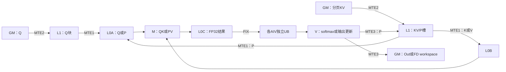
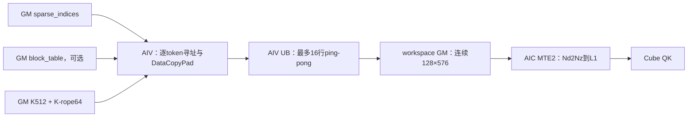
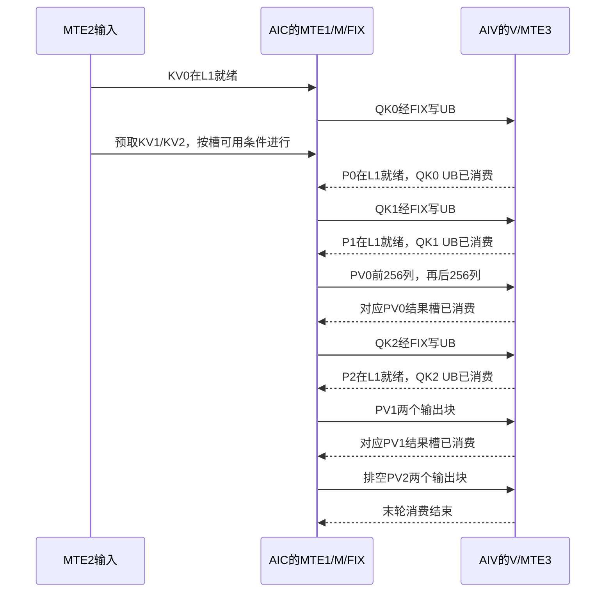
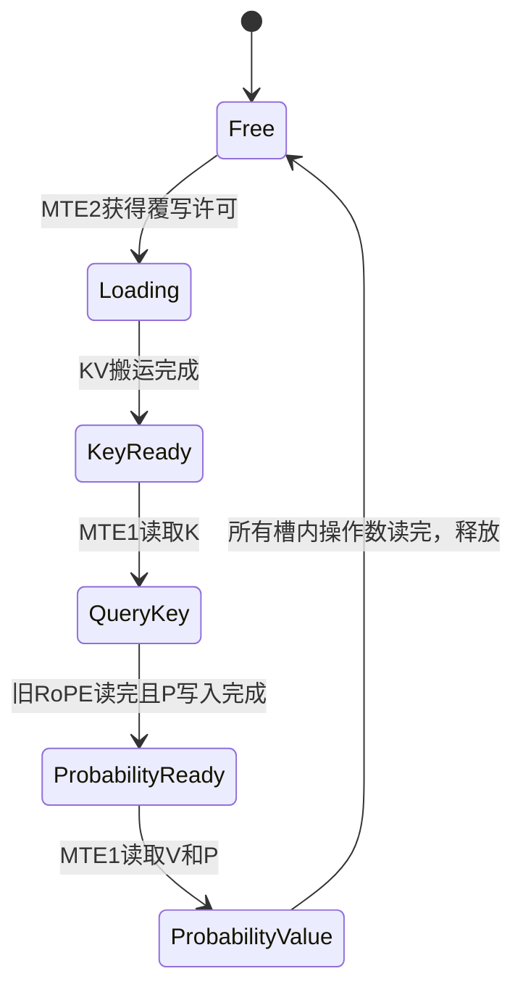
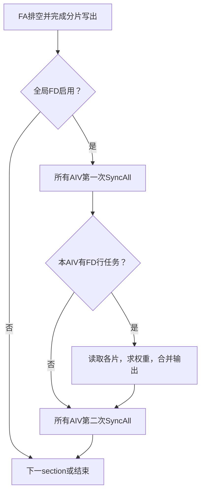

# FlashAttention：从流程分解到流水编排

前篇[语义与流程分解](semantics-and-decomposition.md)确定每个任务必须完成的计算。本篇将任务映射到存储、执行通路及事件，保留启动、稳态、排空和跨Q边界。数字示范对应当前M96/S112实现；它们不是所有Ascend设备的通用规格。

通用的是任务依赖、执行资源竞争和缓冲生命周期。下文三轮表、三槽状态机和两次全局同步展示当前arch35 MLA实现的一种编排，不规定所有FA都采用这一顺序。独立K/V的FA须分别计入两份输入及其搬运；能否共享缓冲取决于各自最后消费者。

## 1. 先区分计算阶段与执行资源

| 通路/资源 | 本实现负责的工作 | 共享约束 |
|---|---|---|
| MTE2 | Q/KV从GM到L1；mask/FD数据从GM到UB | 各侧搬运、发射及目标槽生命周期仍约束并行 |
| MTE1 | Q/K从L1到L0A/B；P/V从L1到L0A/B | A和B的装载共用此通路，不是两台独立引擎 |
| M / Cube | QK、PV矩阵乘，结果进L0C | QK与PV共享同一AIC的矩阵资源 |
| FIX / Fixpipe | L0C结果送AIV UB | 源L0C和目标UB均须满足读写同步 |
| V / Vector | max/exp/sum、mask、cast、输出更新、FD | 同一个AIV的softmax和输出更新共享V |
| MTE3 | P从UB回L1；Out/统计量从UB写GM | 源UB须保留到搬运读完 |
| Scalar | 寻址、循环、参数、事件发射 | 通路空闲也可能来自发射端，不能全部归因带宽 |

当前1个AIC搭配2个AIV，满M96各处理48行。两AIV主要分Q行，不是把同一行的S2对半后互相求和。L1/L0预算按AIC，UB预算按每个AIV，不能合成共享池。

## 2. 把数据通路画全，尤其是P返回Cube



同一任务i必须`QK_i → softmax_i → P_i就绪 → PV_i → update_i`。跨任务的独立工作才可插进等待窗口；不能让PV_i提前于P_i的生产。

### 2.1 SFA离散gather是另一种输入通路

上图的当前M96/S112实例由AIC侧MTE2直接把分页KV搬入L1。token-wise
`SparseFlashAttention` 的地址由 `sparse_indices` 决定，不能直接使用同一条连续搬运
路径。它先由AIV把离散行整理为连续ND块，再由AIC转成NZ：



两条路径的共同部分仍是 `QK → online softmax/P → PV → 输出更新`；不同的是输入
生产者、L1槽形状和流水阶段：

| 项目 | 当前M96/S112分页MLA | token-wise SFA |
|---|---|---|
| KV进入L1 | AIC MTE2直接按页搬运 | AIV离散gather→workspace GM→AIC Nd2Nz |
| 基本块M轴 | query/head展开后的96行 | 一个query token的G个head，最大64 |
| S2 tile | 112 | 128个已选择token |
| L1槽 | 三个133 KiB KV/P槽 | 三个144 KiB KV/P槽 |
| 稳态阶段 | QK / softmax / PV / update | V0 / MM1 / V1 / MM2 / V2 |

SFA中workspace并非为了保存完整score，而是Nd2Nz的连续源；三槽分别对应新gather、
当前QK/P和上一PV的生命周期。详细地址、三轮runInfo和split-G见
[SFA实例](example-sparse-flash-attention-tokenwise-mla.md)。

当`G>64`启用split-G时，相邻两个AIC各计算一半head，但仍共享同一份top-k KV。
配套的4个AIV把最多128行gather四分后写入同一workspace槽，再由所有AIV在flag 15上
集体到达；无任务AIV也必须空跑相同次数，闲置AIC无需参与。barrier之后，每个AIV才用
本地cross-core事件通知配对AIC，两个AIC各自读取完整KV块。它避免重复随机gather，
代价是全AIV同步和两份Nd2Nz；这是已实现的协同切G机制，但其相对“重复gather、取消
跨AIC同步”的净收益尚无直接A/B。选型与验证边界见
[常见优化技巧§8.2](common-optimizations.md#82-g维协同切分4个aiv共享gather结果)。

## 3. 从单任务链变为跨任务交错

最直接的顺序是`QK0 → softmax0 → PV0 → update0 → QK1`。当前实现让下一QK先走，在等待/消费旧P时穿插新的矩阵工作：

```text
AIC矩阵顺序：QK0 → QK1 → PV0 → QK2 → PV1 → PV2
AIV向量顺序：softmax0 → softmax1 → update0 → softmax2 → update1 → update2
```

这不表示softmax1、PV0必须同时开始。两侧独立发射，通过P-ready、结果就绪和消费者释放信号协调。`PRELOAD_N=2`意味着PV落后`PRELOAD_N−1=1`个任务，不能按名字解释成落后两轮。

### 三个KV任务的通路泳道表

列为程序轮次，不是固定时长的时间格。同格多项按依赖执行；MTE与计算是否实际重叠要看trace。这里没有第4个任务，所以轮2不预取KV3。

| 通路 | 启动/轮0 | 轮1 | 轮2 | 排空 |
|---|---|---|---|---|
| MTE2输入 | 发KV1；补发Q/KV0 | 发KV2 | 无新KV | 无 |
| MTE1操作数 | 装Q/K0各段 | 装Q/K1各段，再装P0/V0 | 装Q/K2各段，再装P1/V1 | 装P2/V2 |
| M矩阵 | QK0 | QK1 → PV0 | QK2 → PV1 | PV2 |
| FIX结果 | score0→UB | score1→UB；PV0前/后256列→UB | score2→UB；PV1前/后256列→UB | PV2前/后256列→UB |
| V向量 | softmax0 | softmax1 → update0 | softmax2 → update1 | update2，末块归一化 |
| MTE3输出 | P0→L1 | P1→L1 | P2→L1 | 最终Out或分片Out/统计量→GM |

其中P0的MTE3可延伸到后续发射窗口，PV0必须等它完成。FA中间tile通常只更新UB累计状态，不每轮都将最终Out写GM。

### 逐任务交接图



该图只排列交接关系；QK与softmax可在独立任务间重叠，消息上下位置不代表真实持续时间。完整的通路轮次以泳道表和`ExecuteTask`源码为准。

## 4. 为什么三槽KV/P正好对应三个任务阶段

稳态要同时保留上一任务的V/P、当前任务K/softmax输入、下一任务预取KV。槽号`loop%3`只是寻址，安全性来自生产消费协议。

```text
轮i：   槽(i-1)%3：PV消费  | 槽i%3：QK/P生产 | 槽(i+1)%3：KV预取
轮i+1：旧PV槽释放后，才可作为再下一块KV的预取槽
```

单槽容易说明正确性，但限制重叠；双槽适合两个同时存活阶段；三槽适合此处三个阶段。槽数不是独立调参：减槽可能让预取覆盖旧PV，增槽又会挤掉Q/P或超L1。

每个槽可理解为状态机：



图省略了计算与搬运的内部子状态，不能据此提前发布具体API的event。

## 5. 缓冲复用必须满足两种通知

正向通知证明“新数据可读”；反向通知证明“旧数据读完，可覆盖”。只保留前者容易覆盖慢消费者，只保留后者会读尚未到达的数据。

| 缓冲/数据 | 生产者 → 消费者 | 数据就绪 | 可覆写条件 |
|---|---|---|---|
| L1 Q单槽 | MTE2 → MTE1 | Q已搬入 | 旧Q的最后MTE1读取结束 |
| L1 KV/P槽 | MTE2、MTE3 → MTE1 | K/V到位；两侧P到位 | PV对V/P的最后读取结束 |
| L0A/B操作数 | MTE1 → Mmad | A/B装载完成 | Mmad不再读取相应区域 |
| L0C结果 | Mmad → FIX | 矩阵累计完成 | FIX读取结束 |
| QK UB单槽 | FIX → V | score写完并通知 | softmax读完并回传消费确认 |
| P staging | V → MTE3 | cast/排列完成 | P的MTE3读取结束 |
| PV UB两个槽 | FIX → V | 对应N块写完 | 对应N块更新读完并归还 |
| 输出累计UB | V → V/MTE3 | 当前递推完成 | 不再被后续递推/写回读取 |

本实现用L0B槽对应的Mutex保护一组A/B操作数，依赖当前A地址轮换和B游标顺序。`lastMatmulWasPv_`处理连续PV边界，不能把它当无效的游标修饰。C++函数返回不代表异步消费者结束。

## 6. Q跨KV驻留与换Q边界

同一Q块跨多个KV任务时，L1完整Q和L0A驻留部分都可复用。换Q块时：

```text
旧Q最后一个QK的MTE1读取结束
    → 释放L1 Q保护
    → 允许新Q的MTE2预取覆盖单槽
    → 新Q首KV任务刷新L0A驻留部分
```

当前`ExecuteTask`在当前任务是旧Q末tile、下一任务是新Q首tile的安全边界提前预取Q。不能只看“还有下个任务”就无条件预取下一Q。

sum/max使用`mloop%3`保存Q块状态，exp使用`loop%3`保存KV任务alpha。PV错后一轮时要取它自己的runInfo。最容易出错的测试点是换Q、换batch、尾M、尾S2及排空；只测一个长Q块会遗漏这些问题。

## 7. Q临时区与P共享地址时的关键依赖

当前L0A的前18 KiB保留Q每行前96维；另外24 KiB装Q128、21 KiB装Q112/P。QK最后一次Q112读取发生在倒数第二段，最后一段使用另一块Q128区域。

```text
QK_i倒数第二段读Q112完毕 ───┐
                            ├→ 可将P_(i-1)写入共享区 → PV_(i-1)
两个AIV已把P_(i-1)写到L1 ───┘

QK_i最后一段读Q128：有机会与上述P搬运交叠
```

P_i必须等QK_i和softmax_i，所以不能靠这个地址安排提前产生同一任务的P。Q96和P可以共存；Q112和P只能分时使用。要证明重叠收益还需MTE1/M trace，空间可行只是第一步。

## 8. PV分段写出如何改变消费者等待

输出宽512按256+256计算。P只装一次，每个输出块沿112个KV token分64+48归约；完成一个输出块就FIX到UB并通知AIV。

```text
前256列：计算 → FIX → AIV更新前半
后256列：        计算 → FIX → AIV更新后半
```

这提供AIV提前消费的机会，但还需看真实反压。接收端`dstStride=256`，累计输出stride=512，不能把两者合成一个值。改N分块要同时检查L0B操作数大小、L0C结果、UB接收区、flag数量和后半输出正确性。

## 9. section结束与跨核FD

主FA任务结束先排空延迟的PV/Vector工作，写好分片Oj/mj/lj。若metadata的全局FD开关启用，所有AIV必须一致参与外层两次同步：



第一次保证分片可见，第二次保证后续section不会过早复用相关空间。FA/FD复用业务UB，但本实现FD保留前120 KiB的CV交接区；不能只凭“分阶段”就把所有地址重叠。

## 10. 用等待定位优化，而非根据busy猜原因

例如FIX长时间等PV接收槽：先找ProcessVec2是否未消费，再看它等前一任务状态、Vector执行还是其他事件。若PV等P-ready，沿softmax、cast、P写回反查；若MTE2预取晚，既可能是地址发射晚，也可能是旧PV没有释放目标槽。

一条可修改的假设应包含：被阻塞节点、等待的数据、生产者为何迟到、提前工作后的容量和最后消费者。优化候选见[常见技巧](common-optimizations.md)；完整地址与实际函数见[当前例子](example-mla-m96-s112-bsnd-paged-kv.md)。
