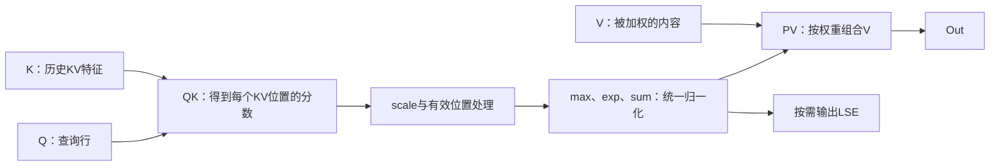
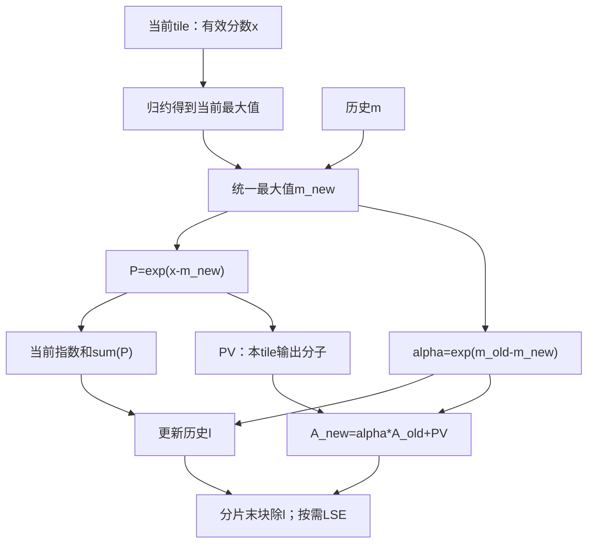

# FlashAttention：从算子语义到流程分解

本篇讨论softmax attention前向的共同计算：QK、有效位置处理、softmax、PV与可选LSE，再决定可以怎样分块。核内在线归约和跨核合并不依赖K/V是否共享存储；Q/K/V头映射、mask和输入布局由目标接口确定。当前MLA作为具体例子，K/V共享约定单列说明。下一篇[从流程到流水](flow-to-pipeline.md)才引入存储位置、执行通路和并行顺序。具体数字与地址在[当前工程例子](example-mla-m96-s112-bsnd-paged-kv.md)中展开。

## 1. 先划定算子边界

FA kernel的边界通常是已准备好的Q/K/V到attention输出；输入投影、位置编码、KV更新和输出投影是否融合，必须以目标接口为准。多头、分组查询和单KV头的行到KV头映射也不能直接互换。

作为本篇实例，模型中的MLA可能包含Q/K投影、KV压缩、RoPE、attention和输出投影。本库讨论的`FlashMlaWithKvcache`负责已准备好的Q与分页KV cache之间的attention，输出加权latent表示；不在这个kernel中生成模型投影权重，也不包含后续V projection。

接口语义先回答下列问题：

| 对象 | 必须确认的含义 | 决定的流程 |
|---|---|---|
| Q | batch、query token、head如何排列；特征维是否已含RoPE | 行展开、QK特征覆盖、Q复用 |
| KV cache | 是否分页、KV头数、K/V是否共享latent | 页表寻址、K/V搬运是否能复用 |
| 有效长度 | 物理分配长度和实际参与计算长度是否相同 | 尾块、空行、无效输出 |
| mask | 无mask、右下因果或其他语义 | 允许遍历的KV范围、tile内部屏蔽 |
| Out / LSE | 输出布局、dtype、是否返回LSE | 转换、归一化和最终写回 |
| metadata | 谁生成、每核任务区间和分片输出位置 | FA分工、workspace、FD同步 |

数学语义不能从BBND、NZ这些布局名称推断。先核对目标接口、golden和实际读写，再解释优化。

## 2. 两次矩阵乘是怎样连接的

对每个query/head的行r、有效KV位置t：

```text
score[r,t] = scale × dot(Q[r,:], K[t,:]) + mask[r,t]
weight[r,t] = exp(score[r,t]) / sum_u exp(score[r,u])
Out[r,:] = sum_t weight[r,t] × V[t,:]
LSE[r] = log(sum_t exp(score[r,t]))
```

实际实现用减最大值的稳定形式，不直接对大分数求exp。符号中的mask是数学上的有效/无效关系，代码可能用布尔张量、负值哨兵或遍历范围实现。



这张图表示逻辑依赖，没有承诺score或完整weight矩阵一定物化到GM。

## 3. 当前MLA为何能让K和V共享一份cache

当前工程每个token的逻辑cache是576个元素：前512个latent/nope，后64个RoPE。QK使用全部576维；PV把前512维当作V。代码证据是本地[Cube文件](sources/flash_mla_with_kvcache_block_cube.h)中`CopyKeyAndRopeTile`、`IterateBmm2`及其K/V同源注释。

```text
逻辑token cache： [ latent/nope：512个元素 | RoPE：64个元素 ]
QK使用范围：     [--------------- 全部576维 ---------------]
PV的V使用范围：  [--------- 前512维 --------]
```

因此V与K的前512维相同；完整K576与V512的形状不同。这里的V是压缩域参与PV的表示，不等同于模型展开后的独立V头向量。其他attention若有独立V，仍须保留对应输入搬运。

令物理页p由`block_table[batch, token//block_size]`取得，页内位置t为`token%block_size`，特征下标d：

| 当前单KV头布局 | 物理shape | 一个token的第d个特征 |
|---|---|---|
| PA_BBND | [pages, block_size, 1, 576] | cache[p,t,0,d] |
| PA_BNBD | [pages, 1, block_size, 576] | cache[p,0,t,d] |
| PA_NZ | [pages, 1, 36, block_size, 16] | cache[p,0,d//16,t,d%16] |

NZ的前32个特征块对应V512，后4个对应RoPE64；一个token的512个元素不一定在GM连续。分页连续性、布局变换和数学共享是三个不同问题。

### 3.1 SparseFlashAttention怎样改变KV集合

上述 `FlashMlaWithKvcache` 对有效KV范围分块遍历；arch35
`SparseFlashAttention` 则为每个query token提供一行 `sparse_indices`，只对被选择的
token做QK和PV。对一行query/head，数学上等价于：

```text
I = 当前query token的有效sparse_indices
K_sparse = K[I, :]
V_sparse = V[I, :]
Out = softmax(scale × Q × K_sparse^T) × V_sparse
```

当前SFA同样是MLA-absorb：QK使用nope512+RoPE64，PV使用K的前512维。
其接口保留 `value` 参数，但arch35实现未读取独立value；真机将value替换为全0或全7
时输出逐比特不变。这个结论只属于当前SFA路径，不能据此删除其他FA的独立V。

SFA的一个基本块只处理一个query token，因为不同token通常有不同索引集合；该token的
全部G个query head共享同一份稀疏KV，因此矩阵M轴装G个head。KV tile固定最多128个
已选择token，循环数为 `ceil(effectiveK/128)`。完整语义、物理寻址和case见
[SparseFlashAttention token-wise MLA实例](example-sparse-flash-attention-tokenwise-mla.md)。

## 4. 把逻辑轴分清，才能分解计算

设每块处理M个query/head行、S2个KV token，QK特征宽D，V特征宽DV。矩阵乘记为`A[M,K]×B[K,N]`：

| 阶段 | 数学shape | 矩阵乘M/N/K |
|---|---|---|
| QK | Q[M,D] × Kᵀ[D,S2] → score[M,S2] | M / S2 / D |
| PV | P[M,S2] × V[S2,DV] → partial[M,DV] | M / DV / S2 |

S2在QK中是输出列轴，在PV中是求和轴。PV的输出列分块属于DV，不能和KV token分块混为一谈。

当前BSND、单KV头路径按`行号 = query_token×Q_head数 + head`展开。Q_head数为96时，96行正好对应一个token的所有头；其他头数仍按通用行映射处理。M96不是“只支持96头”，Q96也不是“96行”：后者指每行前96个特征。

## 5. 为什么要把KV方向拆成多个tile

若把完整分数矩阵留到最后再softmax，存储随`query行数×KV长度`增长。当前长KV示例的完整FP32分数需`8×96×128000×4=375 MiB`；即使仅一个M96块也需46.875 MiB，无法放入小型片上工作区。

沿KV分块后，只需保留当前tile分数，以及每行跨tile累计的三个状态：

| 状态 | 含义 | 为什么不能只留当前tile |
|---|---|---|
| m | 已处理KV的最大分数 | 后续exp必须与历史使用同一基准 |
| l | 相对m的指数和 | 所有KV位置共享一个softmax分母 |
| A | 相对m的未归一化输出分子，宽DV | 保留已处理KV对输出的贡献 |

完整score矩阵方案也可正确；在线归约是降低中间存储/搬运的一种实现方法，不能把具体变量布局当作数学唯一实现。

## 6. 核内在线归约的完整递推

当前tile的有效score记为x，当前V记为V_tile。历史状态与当前tile合并：

```text
m_new = max(m_old, max(x))
alpha = exp(m_old - m_new)
P_tile = exp(x - m_new)
l_new = alpha*l_old + sum(P_tile)
A_new = alpha*A_old + P_tile*V_tile
分片末tile：O_local = A_new/l_new
            LSE_local = m_new + log(l_new)
```

P_tile此时不是完整softmax权重，它尚未除完整分片sum。源码把P转成FP16/BF16供Cube计算，统计量和输出累计为FP32；数学恒等式不等于设备没有舍入误差。



首tile直接初始化或以正确的0/−inf状态进入更新；无效列不能参与max/sum。未定义的历史A不能靠“乘零”保证安全。全mask/空行的Out与LSE语义以目标工程为准，不机械套`0/0`。

## 7. 核内reduce与多核FlashDecode是两层问题

tile内reduce求当前行的max和sum；核内递推合并该核负责的多个tile。只有同一Q行的KV范围还被拆给多个核时，才要再次合并各核结果。

跨核拆S2后，各片必须覆盖目标有效KV范围且不重复。每片可保存未归一化分子A_j，也可保存归一化输出O_j；合并时必须与实际格式匹配。以下采用当前MLA实现的格式。

当前workspace保存归一化后的`O_j=A_j/l_j`、最大值m_j、指数和l_j。全局合并为：

```text
m = max_j(m_j)
t_j = exp(m_j-m)*l_j
l = sum_j(t_j)
Out = sum_j((t_j/l)*O_j)
LSE = m + log(l)
```

若另一个实现保存的是未归一化A_j，合并公式须相应调整。不能对两种workspace格式使用同一解释，也不能直接平均各片O_j。

手算：第一片两个score=0，V都为1；第二片一个score=ln3，V=10。正确片权重2/5和3/5，Out=6.4；直接平均两个局部输出得到5.5；漏掉l_j得到7.75。可运行的数学正反对照见[verify_math.py](scripts/verify_math.py)。

## 8. 从公式得到可执行任务，而不提前绑定流水

```text
解析有效Q/KV范围与任务分配
    → 取得一个Q块、当前KV tile
    → QK特征归约
    → 有效列处理、tile内max/sum、核内状态更新
    → 形成P、执行PV、更新输出分子
    → 继续该Q分片的KV tile
    → 分片末尾归一化
    → 直写最终输出，或写分片结果等待FD
    → 可选多核合并与最终写回
```

这条链用于审查计算是否完整。已有正确kernel或golden时直接沿用，不要求为了优化重写串行基线。接下来才把独立任务放到不同通路、确定并发缓冲和同步，见[流程分解到流水编排](flow-to-pipeline.md)。
