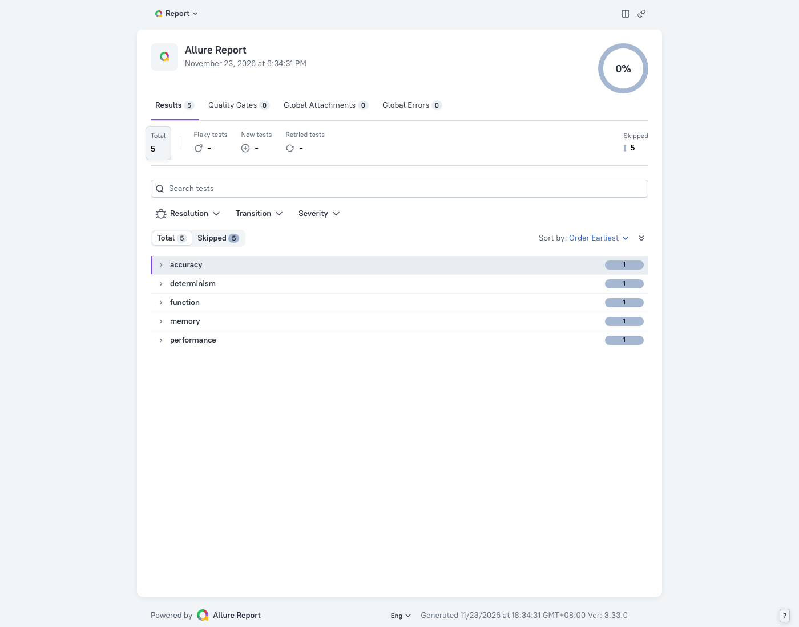

# Allure 与已有 Grafana 接入

这是可选的文件适配层，不改变测试、2.1 判定或原有 HTML / CSV。`export_platform.py` 仅用 Python 标准库，不连接网络，不安装平台或采集设备数据。先从技能目录执行以下离线示例。

## Allure：结果、附件和历史

```bash
RUN_DIR=$(mktemp -d /tmp/torch-op-platform.XXXXXX)
python3 scripts/export_platform.py allure assets/report-example.json \
  --out "$RUN_DIR/allure-results"
```

每个专项结果生成一个 `*-result.json` 及原始记录 JSON 附件，保留逐叶三方比较。输出目录须为新目录。示例是 synthetic，Allure 中全部显示 skipped，不能当作硬件通过记录。



该图由实际 Allure CLI 生成：五个专项各一条结果，全部跳过。展开条目可查看原始状态、参数和 JSON 附件。

使用已有 Allure CLI 生成网页；先保存 `allure --version` 和 CLI 帮助，按所安装版本选择输出参数。安装和历史保留参见 [Allure 官方文档](https://allurereport.org/docs/)。Allure 安装在报告环境即可，不需要改测试容器中的 Torch / CANN。

```bash
# Allure 3.33.0 已验证的生成命令；输出使用新目录。
allure generate "$RUN_DIR/allure-results" --output "$RUN_DIR/allure-report"
```

| 原始状态 | Allure 状态 |
| --- | --- |
| PASS | passed |
| FAIL | failed |
| ERROR / TIMEOUT / BLOCKED | broken |
| MEASURED / NOT_RUN / UNSUPPORTED / NOT_APPLICABLE | skipped |

synthetic / unverified 记录统一 skipped；hardware 的 PASS 若引用文件缺失则显示 broken。所有行的原状态均在说明和附件保留。Allure 展示的是专项结果，不能将平台通过率等同于算子正式 2.1 验收。

默认只附结构化结果，不复制引用文件。确认获准交付后加 `--include-evidence`，复制该行 `evidence` 和 `reproduction` 引用的文件。复现清单的其他依赖不会递归收集；需要完整复现包时先打包为获准的证据附件再引用。结构化记录本身也可能含受限信息，上传前同样检查。

历史身份使用 API、case_id、阶段、专项、执行端、标杆和参数，不含本轮 run ID。生成新结果时 UUID 独立。确保 case_id 稳定，在结果 metadata 的 dtype / input_dtype、shape、layout、attrs、case_parameters 中保留区分用例的参数；多输入、种子和计算模式可放 case_parameters。更换标准或输入语义时应能区分。跨批趋势还需按 Allure 版本保留其历史存储，不将多个批次误当成一次 launch 的重试。

## Grafana：复用已有 Prometheus

路径为 `执行器 → 进度 JSON → .prom 文件 → 已有 Node Exporter → Prometheus → Grafana`。不新增 HTTP 服务，不自动更改已有平台配置。

导出最终结果与进度示例：

```bash
python3 scripts/export_platform.py prometheus \
  --bundle assets/report-example.json --stream worker-1 \
  --out "$RUN_DIR/torch_op_results.prom"
python3 scripts/export_platform.py prometheus \
  --progress assets/progress-example.json --stream worker-1 \
  --out "$RUN_DIR/torch_op_progress.prom"
```

两个文件代表不同数据源：最终结果按 suite / status 汇总；进度来自执行器快照，不能由最终报告推断。指标均为快照 Gauge。每次导出在同目录写临时文件后原子替换，解析错误保留上次完整文件；父目录须已存在。新 .prom 文件权限为 0644，更新时保留已有权限；进度 JSON 默认 0600。仍需由执行方确认目录及平台读取权限。

接入现有平台只需：

1. 确认 Node Exporter 已启用 `--collector.textfile.directory`，由平台管理员提供可写目录。将上述输出改到该目录，确认 Node Exporter 账户可读；只上传批准范围内的数据。
2. 确认现有 Prometheus 已采集这个 Node Exporter；在 Grafana 导入 [看板 JSON](../assets/grafana-dashboard.json)，选择已有 Prometheus 数据源。
3. 演示时将看板 evidence_class 从默认 hardware 切到 synthetic；示例时间是固定旧值，不代表当前任务。正式接入由执行器产生真实时间。

只有 Grafana、没有指标数据源或可用 exporter 时，还需要平台侧配置，本适配器不会自动完成部署。参见 [Node Exporter textfile collector](https://github.com/prometheus/node_exporter#textfile-collector)。

### 执行器接入：开始、结束和心跳

执行器维护累计快照，可导入 `scripts/export_platform.py` 中的 `write_progress(path, data)` 和 `export_prometheus(path, stream, progress_path=...)`。以下是单槽任务的简化示例；将开始、结束更新放在用例边界，心跳由已有调度器定期执行。

```python
import time
from pathlib import Path
from export_platform import write_progress, export_prometheus

snapshot = Path("run/progress.json")
started = time.time()
data = dict(schema_version=1, evidence_class="hardware", state="running",
            planned=1, completed=0, failed=0, running=1,
            started_at_seconds=started, updated_at_seconds=started)
write_progress(snapshot, data)
export_prometheus(Path("run/progress.prom"), "worker-1", progress_path=snapshot)
# 在这里执行用例；不要把文件写入、导出或监控采样放进算子计时区间。
# 结束后用实际状态更新 completed / failed / running 和 state，再发布快照。
```

以上 import 需让 Python 能找到技能 scripts 目录，例如执行器启动前设置经过核验的 `PYTHONPATH`。快照目录由执行方准备。示例未调用设备，不是可直接开始训练的脚本。

快照使用[进度示例](../assets/progress-example.json)中的字段：

- planned 是冻结计划的专项执行槽位数，completed 含已结束的成功、失败、错误和跳过；不是通过数。failed 是 completed 中的 FAIL / ERROR / TIMEOUT / BLOCKED 数。多输出叶子及压测重复不能增算独立用例。
- running 是当前正在执行的槽位；多个 rank 先汇总，只有一个协调进程写同一快照。心跳每 15～30 秒或约定间隔更新 updated_at_seconds；外部导出器不得自行刷新这个时间。
- state 为 running / finished / aborted。finished 表示计划已结束，不等于通过；中断时记录实际数量并标 aborted。进度写入失败应记录监控错误，不改变数值结论，也不能静默显示健康。

每个固定 stream 使用固定文件名，新任务重置 started_at_seconds 和计数。一个 Node Exporter 中同一 stream 的同类文件只保留一份，避免重复时间序列；任务退出后发布终态，回收槽位时清理所属文件，避免旧数据长期残留。看板通过开始时间区分轮次，详细 run ID 在原报告查找。

### 看板内容与边界

看板展示计划 / 完成 / 失败 / 运行槽位、心跳年龄、任务状态和最终专项状态分布。指标标签只含固定 stream、evidence_class、suite / status 等有限类别，不加入 run ID、shape、输出叶子或原始张量。

心跳告警可用 `time() - torch_op_progress_updated_at_seconds{evidence_class="hardware"}` 配合 `torch_op_run_state{state="running"} == 1`，阈值按心跳间隔设置；心跳中断也可能是采集链路异常，不直接判定算子卡死。文件被清理后需另设指标缺失告警。

设备利用率、温度和内存曲线继续用已有设备 exporter。本接入不测峰值内存或算子延迟，不替代专项测量，也不会自动将已生成的 Allure / HTML 变成实时页面。Grafana 需执行器持续发布快照才有运行进度。
