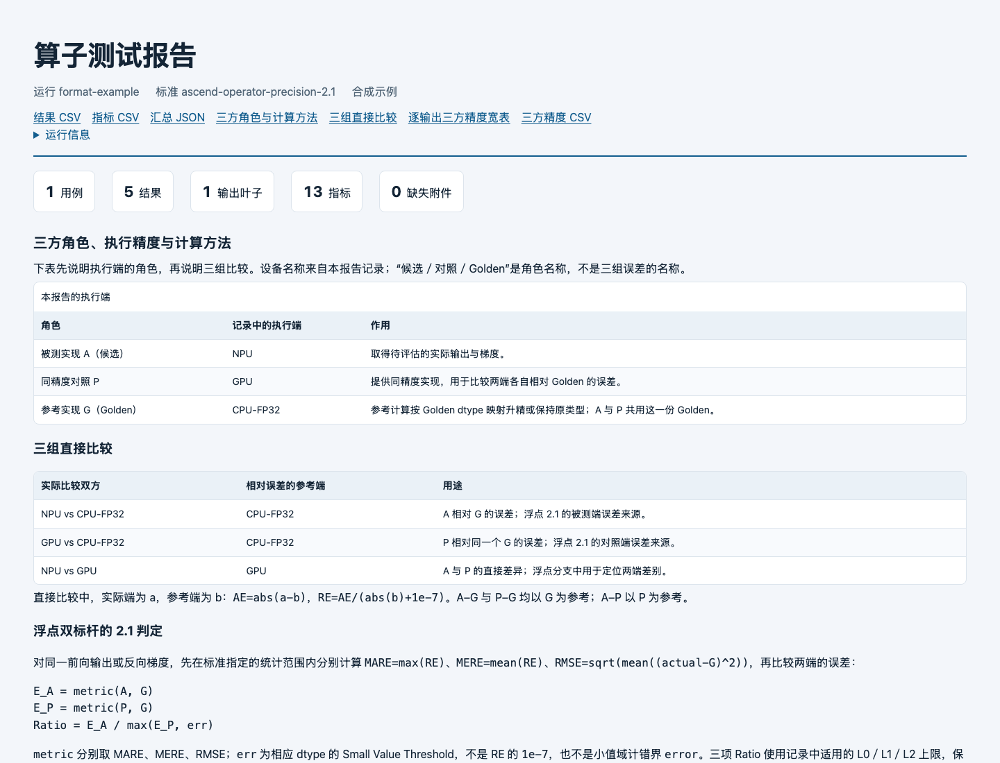
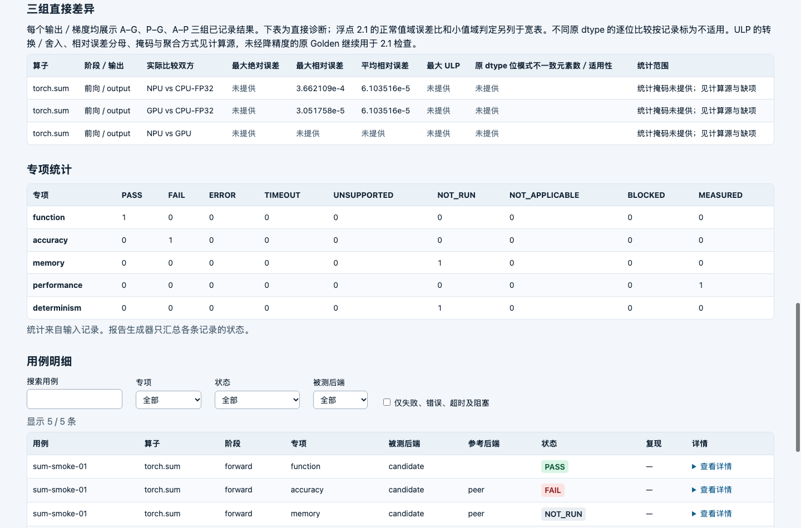
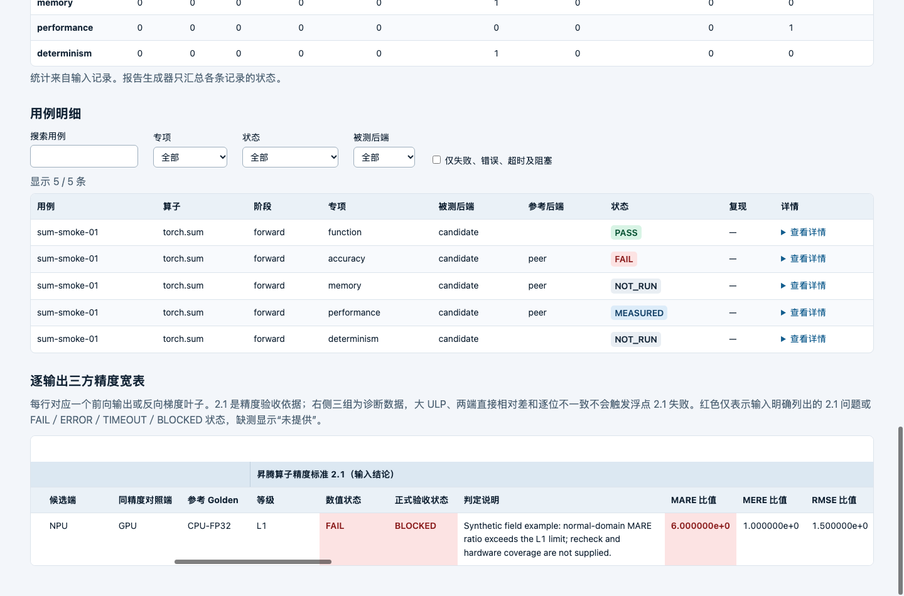
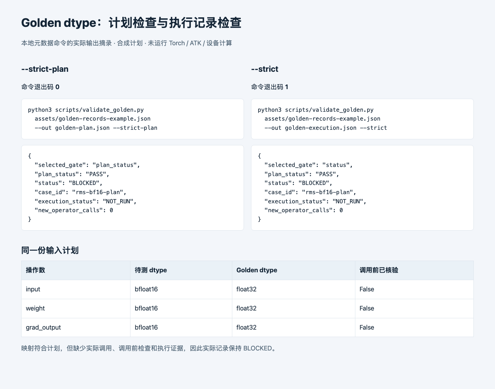

# 使用与报告示例

本页用合成数据演示报告和 Golden dtype 检查；这两类离线命令仅处理本地文件，设备调用次数为 0。正式测试及失败复现需在目标环境安装 ATK，生成对应版本的 case、node 和插件，执行后保存原始结果。

## 提供哪些能力

| 能力 | 输入与输出 |
| --- | --- |
| 单算子与批量用例设计 | 从 API、dtype、shape 和属性准备前向/反向用例；泛化、模型形状与真实输入分别登记 |
| 五项测试流程 | 功能、2.1 精度、内存、性能、确定性分别保留判据与执行结果 |
| Golden dtype 检查 | 校验逐操作数及上游梯度的映射；区分计划合法与实际记录完整 |
| ATK 失败重跑 | 校验复现包哈希，在新目录运行 ATK，保留命令、日志和退出码 |
| 可交换报告 | 从结果 JSON 生成离线 HTML、通用 CSV 和逐输出/梯度三方比较 |

设备执行和数值比较需要目标环境适配器；附带脚本负责元数据检查、ATK 复现启动和报告生成。

## 安装与审阅

主仓合入后可安装单个技能。

```bash
npx skills add ascend-ai-coding/awesome-ascend-skills -s torch-op-validation
```

审阅 PR #148 当前分支时，可克隆作者的 Fork。进入技能目录后执行下文命令。

```bash
git clone --branch feat/torch-op-validation --single-branch \
  https://github.com/easiercloud/awesome-ascend-skills.git
cd awesome-ascend-skills/skills/ops/torch-op-validation
```

在已有计算环境中安装所需 ATK wheel，核对依赖、后端和 CLI 参数。先用一个预期已知的小样确认三方角色和报告，再执行批量任务。[ATK 安装与复现](atk.md)

## 单算子任务

可将以下任务交给使用本技能的 Agent，并补充已授权的环境、设备和 ATK 路径。

```text
使用 torch-op-validation 测试 torch.nn.functional.rms_norm。
先做 L1 配置的冒烟测试，记录 2.1 原文版本、SHA256 和 Golden 映射来源。
input 使用 BF16，shape 为 [64, 1024] 和 [257, 1024]。
weight 使用 BF16，shape 为 [1024]，normalized_shape=[1024]，eps=1e-6。
测试前向及反向，input 和 weight 都需要梯度，保存同一份冻结上游梯度。
候选使用 NPU，同精度对照使用 GPU，Golden 按采用映射使用 FP32。
构造输入标为 generic，记录种子、分布、布局和调用参数。
输出五项测试结果、逐输出/梯度的三方诊断，以及 ATK 单用例失败包。
正式 L1 结论按全部适用的覆盖与执行要求评定。
```

任务配置可参照输入列表、属性和执行角色的 JSON 示例。它需要由执行方转换为当前 ATK 的原生配置。[任务配置](../assets/task-example.json)

## 批量任务

```text
读取 operators.csv，为每行建立稳定 case_id，按 API 签名绑定命名输入与属性。
按精度标准 2.1 生成泛化用例，并导入获准使用的训练和推理调用记录。
model_shape 和 model_dump 分别记录。逐算子核对等级、dtype、格式及参数覆盖。
先完成小样，再执行空闲且获准设备上的测试。
将 ATK 原始状态、2.1 数值与正式结论、三方诊断写入报告，保留失败复现入口。
```

清单列可由项目扩充。以下输入结构与参数单元格使用 JSON，作为 Agent 生成用例的输入。

| case_id | operator | phase | accuracy_level | source_kind | inputs_json | attrs_json |
| --- | --- | --- | --- | --- | --- | --- |
| rms-001 | torch.nn.functional.rms_norm | forward_backward | L1 | generic | `[{"name":"input","dtype":"bfloat16","shape":[64,1024],"requires_grad":true},{"name":"weight","dtype":"bfloat16","shape":[1024],"requires_grad":true}]` | `{"normalized_shape":[1024],"eps":1e-6}` |
| sum-001 | torch.sum | forward | L1 | generic | `[{"name":"input","dtype":"float32","shape":[257,1024]}]` | `{"dim":-1,"keepdim":true}` |

清单中的形状是构造示例。模型调用记录应另附模型版本、模块、训练或 prefill/decode 阶段、实际参数和采集来源。获准的真实输入还需保存张量、梯度及哈希。[用例设计](precision.md#生成与核验用例)

## 生成离线报告

从技能目录运行，使用新的临时目录保存产物。

```bash
RUN_DIR=$(mktemp -d /tmp/torch-op-walkthrough.XXXXXX)
python3 scripts/render_report.py assets/report-example.json --out "$RUN_DIR/report"
printf '%s\n' "$RUN_DIR/report/report.html"
```

生成目录包含以下五个文件。当前示例有 5 条专项结果、13 条指标和 1 个输出叶子的三方比较记录。

```text
report/
├── report.html
├── results.csv
├── metrics.csv
├── precision_comparison.csv
└── summary.json
```

`results.csv` 每条专项结果一行，`metrics.csv` 每项指标一行。`precision_comparison.csv` 按 API、阶段和输出叶子展示三方比较，适合导入表格继续筛选。输入未提供比较行时生成其余四个文件。[报告字段](report.md)



概览截图由随技能提供的合成数据生成，包含结果数量、CSV 下载入口、三方角色和计算方法。示例中的通过、失败和测量值仅用于展示字段。



比较截图展示 A–G、P–G、A–P 三组诊断、五项统计和可筛选的结果行。未提供的指标显示“未提供”，不以 0 代替。浮点双标杆对 A–G 和 P–G 分别计算误差，再检查三项误差比及小值域等规则；A–P 的直接差异用于定位问题。



宽表截图展示 2.1 数值初判、正式状态和误差比。合成示例的 MARE 比值 6 超过 L1 上限 5，标红；缺少真实执行及覆盖，正式状态为 BLOCKED。截图中的 L1 是精度标准等级，与项目测试优先级无关。

2.1 超标、执行错误和关键证据缺失的标准字段标红，并附具体原因。诊断数值本身没有独立通过门槛。正式结论还需核对用例覆盖、执行次数、设备和适用复检。[精度记录](report.md#21-判定记录)

## 检查 Golden dtype

映射文件包含 FP16/BF16→FP32、complex32→complex64，以及 FP32/complex64 保持原类型的规则。任务须登记实际采用的标准和映射来源。其他 dtype 或参考方案按其适用依据配置并记录。[Golden 计算精度](precision.md#golden-计算精度核验)

下例为尚未执行的 BF16 RMSNorm 前后向计划，包含 input、weight 和 grad_output。[计划记录](../assets/golden-records-example.json)

```bash
python3 scripts/validate_golden.py assets/golden-records-example.json \
  --out "$RUN_DIR/golden-plan.json" --strict-plan
```

该命令返回 0，输出 `plan_status=PASS`、`status=BLOCKED`。计划中的输入和梯度 dtype 满足映射，执行记录仍为 `NOT_RUN`。

```bash
python3 scripts/validate_golden.py assets/golden-records-example.json \
  --out "$RUN_DIR/golden-execution.json" --strict
```

同一份计划在执行检查中返回 1，`status=BLOCKED`。生成的 JSON 记录缺少调用前核验和执行证据等原因。可在脚本或 CI 中分别使用两个退出码。



截图展示元数据检查的两种结果。校验器读取执行器导出的记录，设备调用次数为 0，证据引用保留在 JSON 中供核对。

完成设备测试后，由执行器导出各操作数实际的调用前 dtype、检查结果、执行状态和证据引用，再用 `--strict` 检查新记录。需要升精的转换发生在参考调用前，反向使用参考端自身前向缓存及转换后的同一份上游梯度。记录应能追溯到真实执行。

## 五项结果与失败复现

功能检查返回结构、dtype、形状、别名和梯度。精度按 2.1 分类及等级判定，保留三方数据。内存、性能和确定性分别记录测量范围、重复方式及适用判据。[专项测试](specialized-tests.md)

失败包保留原 ATK case ID、配置、插件依赖、输入与梯度、哈希和执行参数。运行助手后查看新 ATK 报告，核对原错误或超差是否出现。`execution.json` 保存命令退出状态，复现状态初始为 `NOT_EVALUATED`。[单用例复现](atk.md#单用例复现)

```bash
python3 scripts/replay_atk.py path/to/repro-case \
  --output path/to/new-repro-run --atk "$ATK_VENV/bin/atk"
```

真实设备测试后，由执行方将 ATK 原始报告和其他专项记录整理为 `bundle.json`，再使用相同渲染命令。参考 dtype 校验、数值判定、覆盖检查和报告渲染各有输入与结果，交付时一并保留原始证据。
